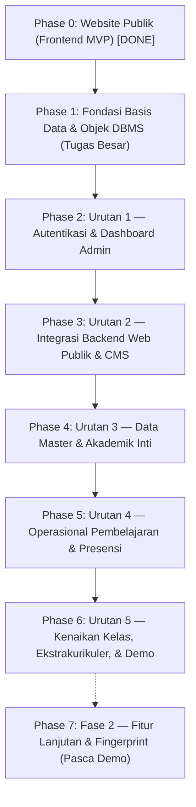

# TASKS.md — Master Implementation Plan: SIAKAD SMP Muhammadiyah 7 Medan

**Versi Dokumen:** v2.0  
**Tanggal Pembaruan:** 3 November 2026  
**Peran:** Senior Software Architect, Frontend Architect, Technical Project Planner  
**Dokumen Acuan:** `PRD.md` (v0.4), `DESIGN.md` (v0.2), `ARCHITECTURE.md` (v0.2)  
**Lingkungan Teknis:** Laravel 12 (PHP 8.4), Tailwind CSS v4.0.0 (Vite), MySQL 8.0 (`siakad_rkm_dev` & RKM CI3), Niagahoster hPanel  
**Fokus Penilaian Akademik:** Penerapan Manajemen Basis Data (Views, Triggers, Stored Procedures, Transactions, Privileges) & Kesiapan Demo Awal Desember 2026  

---

## 1. Project Overview & Status Terkini

SIAKAD SMP Muhammadiyah 7 Medan adalah sistem akademik modern terpadu yang dibangun berdampingan dengan sistem eksisting RKM (CodeIgniter 3). Sistem ini melayani 4 kelompok pengguna utama:
1. **Publik (Tanpa Login):** Portal informasi sekolah, profil, berita, pengumuman, kesiswaan, galeri, dan direktori guru/siswa.
2. **Admin Sekolah:** Pengelolaan autentikasi/akun, CMS konten publik, data master (guru, siswa, kelas, mapel), manajemen akademik (penempatan, penugasan, wali kelas, tahun ajaran), dan kenaikan kelas.
3. **Guru & Wali Kelas:** Jadwal mengajar, pencatatan presensi siswa per pertemuan, unggah materi pembelajaran, serta monitoring/rekap absensi kelas binaan.
4. **Siswa:** Akses jadwal belajar mingguan, materi pelajaran, dan rekap kehadiran pribadi.

### Status Implementasi Codebase Saat Ini:
- **Website Publik (Frontend MVP - 16 Rute):** **SELESAI (DONE)** dengan data fixture dummy terstruktur (`database/dummy/` & `config/sekolah.php`), komponen Blade reusable, dan layout responsif.
- **Test Suite Frontend:** **SELESAI (DONE)** di `tests/Feature/` mencakup verifikasi desain, interaksi menu mobile, filter query direktori, dan kepatuhan privasi DIR-8.
- **Fokus Pekerjaan Sekarang:** Beralih ke **Urutan Pengerjaan PRD Bab 4.3** & **Fondasi Basis Data MySQL 8.0** (Urutan 1 s.d. 5).

---

## 2. Roadmap & Urutan Pengerjaan (Berdasarkan PRD v0.4 Bab 4.3)



---

## 3. Milestone Summary

| Milestone | Fase / Urutan | Sasaran Utama | Target Output / Objek DBMS | Status |
|---|---|---|---|---|
| **M0: Public Web Frontend** | Phase 0 | Antarmuka publik 16 rute responsif | Blade views, CSS tokens, Dummy fixtures, Feature tests | **DONE** |
| **M1: Database Foundation** | Phase 1 (DBMS) | 15 tabel `siakad_*`, Views, SP, Triggers, Privileges | Migrations, `database/sql/*.sql`, Database users | **READY TO START** |
| **M2: Auth & Admin Shell** | Phase 2 (Urutan 1) | Login terpadu multi-role, ubah password, dashboard admin | `siakad_users`, Session guard, Role middleware, Topbar semester | **PENDING** |
| **M3: Public Web Integration**| Phase 3 (Urutan 2) | CMS konten admin, direktori publik membaca DB RKM via view | `v_publik_guru`, `v_publik_siswa`, `siakad_*` konten | **PENDING** |
| **M4: Master Data Engine** | Phase 4 (Urutan 3) | Siswa (~30 kolom + staging Excel), Guru, Kelas, Penugasan | `sp_impor_siswa_commit`, `sp_salin_penugasan`, `sp_salin_walikelas` | **PENDING** |
| **M5: Learning & Attendance** | Phase 5 (Urutan 4) | Jadwal, Sesi Pertemuan, Absensi Siswa, Materi Pelajaran | `siakad_jadwal`, `siakad_absensi_siswa`, Panel Guru & Siswa | **PENDING** |
| **M6: Promotion & Demo** | Phase 6 (Urutan 5) | Kenaikan kelas, ekskul akademik, persiapan demo hosting | `sp_proses_kenaikan_kelas`, `v_pratinjau_kenaikan` | **PENDING** |

---

## 4. Detailed Task Checklist

---

### Phase 0: Website Publik (Frontend MVP) — [STATUS: DONE]

*Fase ini telah diselesaikan secara penuh pada sprint sebelumnya dan terverifikasi oleh test suite di `tests/Feature/`.*

- [x] **`[FE-SETUP-001]`** Setup Laravel 12, Vite, Tailwind CSS v4.0.0 (`@theme` tokens di `resources/css/app.css`). *(Done)*
- [x] **`[FE-COMP-001..005]`** 14+ Blade UI Components (`button`, `badge`, `icon`, `breadcrumb`, `cards`, `pagination`, `empty-state`, `search-input`, `filter-select`). *(Done)*
- [x] **`[FE-LAYOUT-001..004]`** Master layout `layouts/public.blade.php`, responsive navbar (desktop dropdown & mobile drawer), dan 4-column footer. *(Done)*
- [x] **`[FE-PAGE-001..015]`** 16 Rute Halaman Publik (Beranda, Profil [4], Direktori [2], Kesiswaan [3], Galeri, Berita [2], Pengumuman [2], Login placeholder). *(Done)*
- [x] **`[FE-INTERACTION-001..002]`** Interaksi Vanilla JS (drawer, accordion, hero carousel) dan pencarian/filter direktori via HTTP GET query string. *(Done)*
- [x] **`[FE-STATE-001]`** Data fixtures dummy terstruktur di `database/dummy/` dan konfigurasi sekolah di `config/sekolah.php`. *(Done)*
- [x] **`[FE-QA-001..004]`** Cross-breakpoint testing, audit aksesibilitas WCAG AA, audit performa bundle, dan verifikasi proteksi privasi DIR-8. *(Done)*

---

### Phase 1: Fondasi Basis Data & Objek DBMS (Fokus Penilaian Tugas Besar)

*Fase teknis wajib untuk mempersiapkan objek database MySQL 8.0 di lingkungan `siakad_rkm_dev` sebelum fitur backend dibangun.*

#### [DB-MIGRATE-001] DDL 15 Tabel Baru `siakad_*` (Laravel Migrations)
- **Phase:** Phase 1
- **Priority:** P0
- **Status:** Not Started
- **Category:** Database
- **Description:** Membuat migration Laravel khusus untuk 15 tabel `siakad_*` MVP tanpa menyentuh atau merusak 21 tabel eksisting RKM. Dilarang menggunakan `migrate:fresh`.
- **Source Requirements:** `ARCHITECTURE.md` Bagian 8.1, 8.2, 8.3; `PRD.md` Bab 5 & 8.
- **Dependencies:** Koneksi database `siakad_rkm_dev` aktif.
- **Implementation Notes:**
  - Tipe ID memakai `integer()` bertanda (INT signed) agar serasi dengan relasi RKM. Relasi join lintas tabel hanya via ID integer (bukan kolom teks) untuk menghindari konflik charset `latin1` vs `utf8mb4`.
  - 15 Tabel: `siakad_users`, `siakad_admin_profiles`, `siakad_password_reset_requests`, `siakad_jadwal`, `siakad_pertemuan`, `siakad_absensi_siswa`, `siakad_materi`, `siakad_materi_kelas`, `siakad_berita`, `siakad_pengumuman`, `siakad_fasilitas`, `siakad_galeri`, `siakad_galeri_foto`, `siakad_ekstra_publik`, `siakad_prestasi_publik`, `siakad_log_aktivitas`, `siakad_impor_siswa`, `siakad_impor_siswa_baris` (staging).
  - Terapkan `ON DELETE RESTRICT` pada semua FK fisik.
- **Acceptance Criteria:**
  - [ ] Perintah `php artisan migrate` mengeksekusi migrasi tabel `siakad_*` tanpa galat.
  - [ ] Seluruh 21 tabel asli RKM tetap utuh dan tidak mengalami perubahan skema.
- **Verification:** Jalankan `SHOW TABLES LIKE 'siakad_%'` di MySQL CLI.

---

#### [DB-VIEW-001] Implementasi Database Views (`v_publik_*` & `v_periode_aktif`)
- **Phase:** Phase 1
- **Priority:** P0
- **Status:** Not Started
- **Category:** Database
- **Description:** Menyusun view database dengan `SQL SECURITY DEFINER` untuk menyajikan data terfilter dan melindungi kolom sensitif langsung di level DBMS.
- **Source Requirements:** `ARCHITECTURE.md` Bagian 8.4; `PRD.md` DIR-1, DIR-2, DIR-8.
- **Dependencies:** `DB-MIGRATE-001`
- **Implementation Notes:**
  - `v_periode_aktif`: Menampilkan kode `tasm` aktif dari tabel `tahun` (`aktif = 'Y'`) dan tahun `ta` (4 digit pertama).
  - `v_publik_guru`: Mengambil data dari `m_guru` (`stat_data != 'M'`), relasi mapel (`t_guru_mapel`), mengecualikan NIP, alamat, telepon, dan foto.
  - `v_publik_siswa`: Mengambil siswa yang ditempatkan pada `t_kelas_siswa` pada `ta` aktif, mengecualikan NIS, NISN, NIK, tanggal lahir, kontak, nilai, dan foto.
  - `v_publik_berita`, `v_publik_pengumuman`, `v_publik_fasilitas`, `v_publik_prestasi`: Konten berstatus `published`.
- **Acceptance Criteria:**
  - [ ] Query `SELECT * FROM v_publik_guru` dan `v_publik_siswa` tidak memuat kolom sensitif.
  - [ ] View periode aktif mengembalikan satu baris periode berjalan secara akurat.
- **Verification:** Eksekusi file SQL view di `database/sql/views.sql` dan lakukan query pengujian.

---

#### [DB-SP-001] Stored Procedures Bertransaksi untuk Operasi Multi-Tabel
- **Phase:** Phase 1
- **Priority:** P0
- **Status:** Not Started
- **Category:** Database
- **Description:** Membuat Stored Procedures yang membungkus transaksi (`START TRANSACTION`, `COMMIT`, `ROLLBACK`) untuk menjamin integritas data ACID pada operasi multi-langkah.
- **Source Requirements:** `ARCHITECTURE.md` Bagian 8.6, 8.8; `PRD.md` Bab 5, SIS-9, KNK-9.
- **Dependencies:** `DB-MIGRATE-001`, `DB-VIEW-001`
- **Implementation Notes:**
  - `sp_impor_siswa_commit`: Memindahkan data valid dari tabel staging `siakad_impor_siswa_baris` ke `m_siswa` dan `t_kelas_siswa` dalam satu transaksi (jika gagal di tengah, rollback penuh).
  - `sp_akun_siswa_massal`: Membuat akun di `siakad_users` untuk siswa yang belum berakun pada tahun aktif.
  - `sp_salin_penugasan_guru`: Menyalin penugasan dari periode asal ke periode tujuan tanpa menimpa data yang sudah ada.
  - `sp_salin_walikelas`: Menyalin penetapan wali kelas antar-periode.
  - `sp_salin_jadwal`: Menyalin jadwal pelajaran dengan validasi bentrok.
  - `sp_proses_kenaikan_kelas`: Membaca status `t_naikkelas` RKM dan menempatkan siswa ke kelas baru pada `ta` berikutnya.
- **Acceptance Criteria:**
  - [ ] Setiap stored procedure memiliki blok penanganan error (`DECLARE EXIT HANDLER FOR SQLEXCEPTION ROLLBACK;`).
  - [ ] Tidak terjadi *partial commit* saat terjadi kegagalan data di tengah proses.
- **Verification:** Uji eksekusi prosedur dengan skenario data valid dan skenario paksa error (rollback check).

---

#### [DB-TRIGGER-001] Triggers untuk Validasi Bentrok Jadwal & Audit Log
- **Phase:** Phase 1
- **Priority:** P1
- **Status:** Not Started
- **Category:** Database
- **Description:** Membuat trigger di MySQL 8.0 untuk mencegah jadwal bentrok dan mencatat audit aktivitas.
- **Source Requirements:** `ARCHITECTURE.md` Bagian 8.5; `PRD.md` JDW-7, JDW-8.
- **Dependencies:** `DB-MIGRATE-001`
- **Implementation Notes:**
  - `trg_cegah_bentrok_jadwal_guru`: Mencegah guru mengajar di 2 kelas berbeda pada hari dan jam yang bertubrukan dalam periode yang sama via `SIGNAL SQLSTATE '45000'`.
  - `trg_cegah_bentrok_jadwal_kelas`: Mencegah 1 kelas menerima 2 mapel berbeda pada jam yang sama.
  - `trg_audit_perubahan_nilai_block`: Trigger pengaman pada tabel nilai RKM (hanya di lingkungan dev) untuk menolak manipulasi langsung dari SIAKAD.
- **Acceptance Criteria:**
  - [ ] Percobaan insert jadwal dengan jam/guru yang bentrok otomatis ditolak oleh database dengan pesan error yang jelas.
- **Verification:** Jalankan query insert jadwal tumpang tindih dan pastikan ditolak DBMS.

---

#### [DB-PRIV-001] Skema Pengguna Database & Hak Akses (Privileges)
- **Phase:** Phase 1
- **Priority:** P1
- **Status:** Not Started
- **Category:** Database
- **Description:** Mengonfigurasi pengguna database terpisah berdasarkan peran aplikasi untuk memenuhi standar keamanan dan penilaian basis data.
- **Source Requirements:** `ARCHITECTURE.md` Bagian 8.7; `PRD.md` Bab 5.
- **Dependencies:** `DB-MIGRATE-001`, `DB-VIEW-001`
- **Implementation Notes:**
  - User `siakad_public`: Hanya hak `SELECT` pada view `v_publik_*` (tidak punya akses langsung ke tabel dasar `m_*` atau `t_*`).
  - User `siakad_app`: Hak `SELECT, INSERT, UPDATE` pada tabel master bersama, CRUD penuh pada tabel `siakad_*`, dan **tanpa hak INSERT/UPDATE/DELETE pada tabel nilai RKM** (`t_nilai*`, `t_naikkelas`).
  - User `siakad_migrator`: Hak DDL penuh khusus pada tabel `siakad_*`.
- **Acceptance Criteria:**
  - [ ] Percobaan kueri update dari akun `siakad_public` ditolak dengan error `Access denied`.
  - [ ] Akun `siakad_app` tidak dapat melakukan modifikasi pada tabel nilai RKM.
- **Verification:** Uji koneksi via PDO / artisan tinker dengan kredensial masing-masing pengguna.

---

### Phase 2: Urutan 1 — Autentikasi & Dashboard Admin

*Fokus: Membangun pintu masuk utama sistem, session guard multi-role, manajemen password, dan kerangka panel admin.*

#### [AUTH-001] Sistem Login Terpadu Multi-Role & Guard Sesi
- **Phase:** Phase 2
- **Priority:** P0
- **Status:** Done
- **Category:** Authentication
- **Description:** Mengganti placeholder `/login` dengan form login terpadu menggunakan model `siakad_users` (bcrypt password hash), pembatasan rate limiting, dan proteksi brute force.
- **Source Requirements:** `PRD.md` AUT-1 s.d. AUT-5; `DESIGN.md` Bab 9; `ARCHITECTURE.md` Bagian 10.
- **Dependencies:** `siakad_users` table
- **Implementation Notes:**
  - Satu pintu login untuk Admin, Guru, dan Siswa via `AuthController`. Sistem otomatis mengarahkan ke dashboard yang relevan sesuai role (`admin` -> `/admin`, `guru` -> `/guru-panel`, `siswa` -> `/siswa-panel`).
  - Pesan kegagalan login generik tanpa membocorkan apakah username terdaftar atau tidak.
  - Rate limiting throttling (5x salah coba per IP/username -> kunci 60 detik).
- **Acceptance Criteria:**
  - [x] Login sukses mengarahkan ke dashboard yang tepat sesuai peran.
  - [x] Login gagal 5x mengaktifkan rate limiter throttling.
- **Verification:** Terverifikasi via test suite 11 kasus uji (`tests/Feature/AuthenticationTest.php`).

---

#### [AUTH-002] Halaman Ubah Password & Mode Wajib Ganti Password
- **Phase:** Phase 2
- **Priority:** P1
- **Status:** Done
- **Category:** Authentication
- **Description:** Membangun form ubah password (password lama, password baru minimal 8 karakter, konfirmasi) dan middleware isolasi "Mode Wajib Ganti Password".
- **Source Requirements:** `PRD.md` AUT-6, AUT-7, AUT-9; `DESIGN.md` Bab 11.
- **Dependencies:** `AUTH-001`
- **Implementation Notes:**
  - Jika flag `wajib_ganti_password = 1` aktif pada akun (misal akun baru dibuat oleh admin), user di-redirect ke `/ubah-password` dengan layout fokus (tanpa sidebar navigasi). Seluruh menu lain terkunci hingga password berhasil diubah via middleware `EnsurePasswordChanged`.
- **Acceptance Criteria:**
  - [x] User dengan flag wajib ganti password tidak bisa mengakses menu dashboard sebelum memperbarui password.
  - [x] Validasi menolak password yang sama dengan username atau NIS.
- **Verification:** Terverifikasi via test suite 11 kasus uji (`tests/Feature/AuthenticationTest.php`).

---

#### [DASH-001] Shell Layout Dashboard Admin & Indikator Periode Akademik
- **Phase:** Phase 2
- **Priority:** P1
- **Status:** Not Started
- **Category:** Layout & Admin
- **Description:** Membangun kerangka dashboard admin dengan sidebar navigasi responsif, topbar kontekstual (menampilkan nama semester aktif, misal *2024/2025 Semester 2*, bukan kode `20242`), kartu statistik ringkasan, dan menu profil.
- **Source Requirements:** `PRD.md` DSH-1, DSH-2; `DESIGN.md` Bab 6.2, 10; `ARCHITECTURE.md` Bagian 7.
- **Dependencies:** `AUTH-001`, `DB-VIEW-001`
- **Implementation Notes:**
  - Sesuai `ARCHITECTURE.md` Bagian 7, panel admin dapat menggunakan Blade kustom terstruktur atau Filament `[USULAN]`.
  - Kartu statistik beranda admin: total guru aktif, siswa aktif, rombel aktif, dan status periode berjalan.
- **Acceptance Criteria:**
  - [ ] Topbar menampilkan nama periode ramah baca dari `v_periode_aktif`.
  - [ ] Navigasi sidebar responsif (berubah jadi drawer di tablet/ponsel).
- **Verification:** Akses rute `/admin` setelah login dan periksa kesesuaian layout visual dengan `DESIGN.md`.

---

#### [ADMIN-AKN-001] Manajemen Akun Admin & Hak Istimewa Admin Utama
- **Phase:** Phase 2
- **Priority:** P1
- **Status:** Not Started
- **Category:** Admin Management
- **Description:** Menyediakan antarmuka bagi Admin Utama untuk mengelola akun admin lain (tambah, edit, nonaktifkan, reset password) dengan proteksi khusus.
- **Source Requirements:** `PRD.md` AKN-3 s.d. AKN-8.
- **Dependencies:** `DASH-001`
- **Implementation Notes:**
  - Admin biasa tidak dapat mengelola akun admin lain atau menonaktifkan Admin Utama.
  - Admin Utama tidak dapat dinonaktifkan atau dihapus oleh siapa pun.
- **Acceptance Criteria:**
  - [ ] Admin biasa mendapat error 403 Forbidden saat membuka menu manajemen akun admin.
  - [ ] Admin Utama dapat membuat akun admin baru dengan password awal ter-hash bcrypt.
- **Verification:** Uji akses rute `/admin/manajemen-admin` menggunakan akun admin biasa vs admin utama.

---

### Phase 3: Urutan 2 — Integrasi Backend Website Publik & CMS Konten

*Fokus: Mengganti fixture dummy pada website publik dengan data database sesungguhnya yang dikelola oleh Admin.*

#### [CMS-PUB-001] Modul Pengelolaan Konten Publik oleh Admin (Berita & Pengumuman)
- **Phase:** Phase 3
- **Priority:** P1
- **Status:** Not Started
- **Category:** CMS
- **Description:** Membangun antarmuka admin untuk membuat, mengedit, menghapus (soft delete), dan mempublikasikan berita serta pengumuman sekolah ke tabel `siakad_berita` dan `siakad_pengumuman`.
- **Source Requirements:** `PRD.md` ADM-1, ADM-2, BRT-4, PGM-4; `DESIGN.md` Bab 11 & 12.
- **Dependencies:** `DASH-001`, `DB-MIGRATE-001`
- **Implementation Notes:**
  - Form memuat judul, slug otomatis/kustom, ringkasan, isi, upload gambar utama (WebP teroptimasi), dan tanggal publikasi.
  - Hanya artikel berstatus `published` yang tampil di website publik.
- **Acceptance Criteria:**
  - [ ] Admin dapat menyimpan draf dan menerbitkan artikel.
  - [ ] Artikel yang diterbitkan otomatis muncul di katalog publik `/berita` dan `/pengumuman`.
- **Verification:** Buat 1 berita baru di panel admin, lalu buka halaman `/berita` publik untuk memverifikasi kemunculannya.

---

#### [CMS-PUB-002] Modul CMS Sarana Prasarana, Prestasi, & Galeri Sekolah
- **Phase:** Phase 3
- **Priority:** P1
- **Status:** Not Started
- **Category:** CMS
- **Description:** Membangun antarmuka admin untuk mengelola katalog fasilitas (`siakad_fasilitas`), galeri foto kegiatan (`siakad_galeri`), dan prestasi siswa publik (`siakad_prestasi_publik`).
- **Source Requirements:** `PRD.md` ADM-3, ADM-4, ADM-5, PRF-8, KSW-6, GAL-4.
- **Dependencies:** `DASH-001`, `DB-MIGRATE-001`
- **Implementation Notes:**
  - Prestasi publik terpisah dari tabel rapor RKM (`t_prestasi`).
  - Unggahan foto galeri dan fasilitas otomatis menghasilkan thumbnail web ringan.
- **Acceptance Criteria:**
  - [ ] Data fasilitas, galeri, dan prestasi di website publik dialihkan dari file dummy ke database.
- **Verification:** Tambah foto galeri di admin dan cek `/galeri` publik.

---

#### [BE-DIR-001] Integrasi Direktori Guru & Siswa ke Database Views
- **Phase:** Phase 3
- **Priority:** P0
- **Status:** Not Started
- **Category:** Integration
- **Description:** Menghubungkan controller halaman publik `/guru` dan `/siswa` untuk membaca data dari view database `v_publik_guru` dan `v_publik_siswa`.
- **Source Requirements:** `PRD.md` DIR-1 s.d. DIR-11; `ARCHITECTURE.md` Bagian 8.4; `DESIGN.md` Bab 8.
- **Dependencies:** `DB-VIEW-001`
- **Implementation Notes:**
  - Menggantikan require array dummy di `routes/web.php` dengan pemanggilan Repository/Model ke view database.
  - Pagination 15-20 data per halaman, filter nama via LIKE, filter mapel dan filter kelas aktif.
  - Tetap menjamin 100% kepatuhan aturan privasi DIR-8.
- **Acceptance Criteria:**
  - [ ] Data yang muncul di `/guru` dan `/siswa` berasal dari tabel master database RKM.
  - [ ] `FrontendQualityAssuranceTest` tetap lulus tanpa kebocoran data pribadi.
- **Verification:** Jalankan `php artisan test tests/Feature/PublicPagesMvpTest.php`.

---

#### [BE-HOME-001] Integrasi Statistik Beranda & Konfigurasi Profil
- **Phase:** Phase 3
- **Priority:** P1
- **Status:** Not Started
- **Category:** Integration
- **Description:** Mengganti angka statistik dummy pada beranda (`BRD-6`) dengan kalkulasi nyata dari database (jumlah siswa aktif di periode berjalan, guru aktif, dan rombel aktif), serta menghubungkan 3 pintasan portal ke database/pengaturan.
- **Source Requirements:** `PRD.md` BRD-6, BRD-8, BRD-9; `ARCHITECTURE.md` Bagian 9.
- **Dependencies:** `DB-VIEW-001`
- **Implementation Notes:**
  - Angka statistik dihitung dari query `COUNT` pada view aktif atau di-cache file dengan TTL pendek (1-2 jam) untuk menghemat CPU hosting 1-core.
- **Acceptance Criteria:**
  - [ ] Label penanda data dummy pada statistik beranda dihapus setelah angka tersinkronisasi ke database.
  - [ ] Waktu pemuatan halaman beranda tetap cepat (< 1 detik).
- **Verification:** Periksa response time dan angka statistik di halaman beranda `/`.

---

### Phase 4: Urutan 3 — Data Master & Manajemen Akademik

*Fokus: Mengelola data guru, siswa, kelas, penempatan, wali kelas, mapel, penugasan, dan akun massal.*

#### [MASTER-GRU-001] Manajemen Data Guru & Status Keaktifan
- **Phase:** Phase 4
- **Priority:** P1
- **Status:** Not Started
- **Category:** Master Data
- **Description:** Membangun CRUD data guru pada tabel bersama `m_guru` dengan pencarian nama, filter status aktif, dan pengelolaan akun login guru.
- **Source Requirements:** `PRD.md` GRU-1 s.d. GRU-6, AKN-1; `DESIGN.md` Bab 11.
- **Dependencies:** `DASH-001`, `DB-MIGRATE-001`
- **Implementation Notes:**
  - Penghapusan guru menggunakan soft delete via kolom `stat_data` bawaan RKM (bukan delete fisik).
  - Saat guru didaftarkan, admin dapat langsung mengaktifkan akun login di `siakad_users`.
- **Acceptance Criteria:**
  - [ ] Admin dapat menambah, mengedit, dan menonaktifkan guru.
  - [ ] Guru yang dinonaktifkan otomatis tidak dapat login dan tidak muncul di direktori aktif.
- **Verification:** Uji tambah guru baru dan nonaktifkan guru via panel admin.

---

#### [MASTER-SIS-001] Manajemen Data Siswa Lengkap (~30 Kolom Berkelompok)
- **Phase:** Phase 4
- **Priority:** P1
- **Status:** Not Started
- **Category:** Master Data
- **Description:** Membangun antarmuka penambahan dan pengeditan data siswa pada tabel `m_siswa` dengan form terstruktur dalam 3 tab (Identitas, Sekolah Asal, Orang Tua/Wali).
- **Source Requirements:** `PRD.md` SIS-1 s.d. SIS-4, SIS-12; `DESIGN.md` Bab 11.
- **Dependencies:** `DASH-001`, `DB-MIGRATE-001`
- **Implementation Notes:**
  - Sesuai `DESIGN.md` v0.2: hanya NIS dan Nama yang berstatus wajib; kolom lain opsional.
  - Kolom tanggal yang kosong di database (`0000-00-00`) ditampilkan kosong di form (bukan teks 0000-00-00).
  - Kolom `inputID` diisi 0 untuk kompatibilitas penuh dengan RKM.
- **Acceptance Criteria:**
  - [ ] Form siswa tersusun rapi dalam 3 tab/accordion dan tidak mengalami layout error.
  - [ ] Penyimpanan berhasil baik saat kolom opsional diisi maupun dikosongkan.
- **Verification:** Simpan satu data siswa baru dan cek langsung di tabel `m_siswa`.

---

#### [MASTER-SIS-002] Impor Data Siswa Massal via Excel (Staging Table & SP Commit)
- **Phase:** Phase 4
- **Priority:** P1
- **Status:** Not Started
- **Category:** Master Data
- **Description:** Mengimplementasikan fitur unggah file Excel data siswa dengan tabel perantara (`siakad_impor_siswa_baris`), validasi baris, pratinjau error, dan eksekusi commit via Stored Procedure bertransaksi.
- **Source Requirements:** `PRD.md` SIS-5 s.d. SIS-11; `ARCHITECTURE.md` Bagian 8.6, 8.8, 12.
- **Dependencies:** `MASTER-SIS-001`, `DB-SP-001`
- **Implementation Notes:**
  - Unggahan diproses per baris ke staging: mendeteksi NIS duplikat atau kolom wajib kosong.
  - Admin melihat ringkasan validasi: X valid, Y error.
  - Tombol "Terapkan Impor" memanggil `sp_impor_siswa_commit`: memindahkan data valid ke `m_siswa` dan membuat penempatan kelas awal dalam 1 transaksi ACID.
- **Acceptance Criteria:**
  - [ ] File Excel tidak valid ditolak dengan daftar baris error yang jelas.
  - [ ] Jika terjadi kesalahan fatal di tengah penyimpanan, seluruh data di-rollback penuh tanpa meninggalkan data separuh.
- **Verification:** Uji unggah template Excel berisi 20 baris data valid dan 2 baris data NIS ganda.

---

#### [MASTER-AKN-001] Pembuatan Akun Siswa Massal & Reset Password oleh Admin
- **Phase:** Phase 4
- **Priority:** P1
- **Status:** Not Started
- **Category:** Master Data & Auth
- **Description:** Membangun fitur pembuatan akun siswa massal untuk siswa aktif yang belum berakun serta tombol reset password paksa oleh admin.
- **Source Requirements:** `PRD.md` AKN-9 s.d. AKN-11; `DESIGN.md` Bab 11.
- **Dependencies:** `MASTER-SIS-001`, `DB-SP-001`
- **Implementation Notes:**
  - `sp_akun_siswa_massal` membuat akun dengan username = NIS, password acak sementara ter-hash, dan flag `wajib_ganti_password = 1`.
  - Password sementara hanya ditampilkan satu kali setelah eksekusi dengan opsi unduh Excel (tidak disimpan dalam bentuk plaintext di database).
- **Acceptance Criteria:**
  - [ ] Admin dapat membuat akun siswa per kelas secara massal.
  - [ ] Siswa login pertama kali dipaksa mengganti password.
- **Verification:** Eksekusi pembuatan akun massal untuk 1 rombel uji dan coba login sebagai siswa.

---

#### [MASTER-AKD-001] Manajemen Kelas, Penempatan Siswa, & Penetapan Wali Kelas
- **Phase:** Phase 4
- **Priority:** P1
- **Status:** Not Started
- **Category:** Academic Management
- **Description:** Mengelola data rombel (`m_kelas`), penempatan siswa per tahun ajaran (`t_kelas_siswa`), penetapan wali kelas per periode (`t_walikelas`), serta modal salin wali kelas antar-periode.
- **Source Requirements:** `PRD.md` KLS-1..3, PNS-1..6, PWK-1..6; `ARCHITECTURE.md` Bagian 8.6; `DESIGN.md` Bab 11.
- **Dependencies:** `MASTER-SIS-001`, `MASTER-GRU-001`
- **Implementation Notes:**
  - Penempatan siswa disimpan per tahun ajaran (`ta` 4-digit).
  - Wali kelas disimpan per semester (`tasm` 5-digit).
  - Terdapat modal "Salin Wali Kelas dari Periode Sebelumnya" yang memanggil `sp_salin_walikelas`.
- **Acceptance Criteria:**
  - [ ] Admin dapat memindahkan siswa ke rombel kelas.
  - [ ] Guru yang ditugaskan sebagai wali kelas otomatis memperoleh hak akses menu wali kelas saat login.
- **Verification:** Tetapkan seorang guru sebagai wali kelas 7A, login dengan akun guru tersebut, dan verifikasi munculnya menu wali kelas.

---

#### [MASTER-AKD-002] Manajemen Mata Pelajaran & Penugasan Mengajar Guru
- **Phase:** Phase 4
- **Priority:** P1
- **Status:** Not Started
- **Category:** Academic Management
- **Description:** Mengelola kurikulum mapel (`m_mapel`), penugasan guru per kelas dan semester (`t_guru_mapel`), modal salin penugasan antar-semester, dan pengecekan dependensi nilai sebelum penonaktifan.
- **Source Requirements:** `PRD.md` MPL-1..3, PGS-1..7; `ARCHITECTURE.md` Bagian 8.6; `DESIGN.md` Bab 11.
- **Dependencies:** `MASTER-GRU-001`, `MASTER-AKD-001`
- **Implementation Notes:**
  - Penugasan guru berlaku per periode semester (`tasm`).
  - Fitur salin penugasan memanggil `sp_salin_penugasan_guru` dengan modal konfirmasi jumlah baris.
  - PGS-7: Penugasan yang sudah memiliki nilai di RKM (`t_nilai*`) dilarang dihapus (hanya dinonaktifkan).
- **Acceptance Criteria:**
  - [ ] Penugasan guru dapat disalin antar-semester dengan 1 klik konfirmasi.
  - [ ] Penugasan yang telah terkait rekaman nilai terlindungi dari penghapusan.
- **Verification:** Uji salin penugasan dari periode 20241 ke 20242.

---

### Phase 5: Urutan 4 — Operasional Pembelajaran & Presensi

*Fokus: Mengelola jadwal mingguan, sesi pertemuan, presensi siswa per mapel, materi pembelajaran, dan panel dashboard guru/siswa.*

#### [OPS-JDW-001] Manajemen Jadwal Pelajaran & Deteksi Bentrok
- **Phase:** Phase 5
- **Priority:** P1
- **Status:** Not Started
- **Category:** Learning Operations
- **Description:** Membangun antarmuka pembuatan jadwal pelajaran per rombel (hari, jam mulai, jam selesai, penugasan mapel) dengan validasi pencegahan bentrok guru dan kelas.
- **Source Requirements:** `PRD.md` JDW-1 s.d. JDW-8; `ARCHITECTURE.md` Bagian 8.5; `DESIGN.md` Bab 11.
- **Dependencies:** `MASTER-AKD-002`, `DB-TRIGGER-001`
- **Implementation Notes:**
  - Jadwal disimpan di `siakad_jadwal` per `tasm`.
  - Dilengkapi fitur salin jadwal antar-periode via `sp_salin_jadwal`.
  - Validasi bentrok dicek di aplikasi dan dijaga ketat oleh trigger database `trg_cegah_bentrok_jadwal_*`.
- **Acceptance Criteria:**
  - [ ] Jadwal mingguan per kelas tampil dalam format grid yang mudah dibaca.
  - [ ] Pendaftaran jadwal bentrok ditolak dengan notifikasi kesalahan yang jelas.
- **Verification:** Coba input jadwal guru A di kelas 7A dan 7B pada hari Senin jam 08.00–09.20.

---

#### [OPS-ABS-001] Sesi Pertemuan & Pencatatan Presensi Siswa per Pertemuan
- **Phase:** Phase 5
- **Priority:** P1
- **Status:** Not Started
- **Category:** Learning Operations
- **Description:** Membangun modul presensi bagi guru untuk membuka sesi pertemuan (`siakad_pertemuan`) berdasarkan jadwal dan menginput status kehadiran siswa (Hadir, Sakit, Izin, Alpa) ke `siakad_absensi_siswa`.
- **Source Requirements:** `PRD.md` ABS-1 s.d. ABS-8, GSW-1; `ARCHITECTURE.md` Bagian 8.2, 8.8.
- **Dependencies:** `OPS-JDW-001`
- **Implementation Notes:**
  - Menggunakan `INSERT ... ON DUPLICATE KEY UPDATE` untuk mencegah baris ganda saat guru menyimpan ulang absensi.
  - Rekap persentase kehadiran otomatis terhitung untuk setiap siswa.
- **Acceptance Criteria:**
  - [ ] Guru dapat mengisi dan memperbarui status kehadiran rombel dengan cepat.
  - [ ] Siswa hanya dapat melihat rekaman kehadirannya sendiri di dashboard siswa.
- **Verification:** Login sebagai guru, pilih jadwal hari ini, buka sesi pertemuan 1, isi absensi, lalu cek rekap di akun siswa terkait.

---

#### [OPS-MTR-001] Manajemen Materi Pembelajaran & Pengunduhan Terproteksi
- **Phase:** Phase 5
- **Priority:** P2
- **Status:** Not Started
- **Category:** Learning Operations
- **Description:** Membangun modul unggah materi (dokumen PDF/Word atau tautan eksternal) oleh guru per penugasan kelas (`siakad_materi`, `siakad_materi_kelas`) dengan controller unduh berotorisasi.
- **Source Requirements:** `PRD.md` MTR-1 s.d. MTR-7, SSW-2; `ARCHITECTURE.md` Bagian 10 & 12.
- **Dependencies:** `MASTER-AKD-002`
- **Implementation Notes:**
  - Berkas materi disimpan di disk privat Laravel (`storage/app/private/materi/`).
  - Pengunduhan melalui route berizin (hanya guru pengampu dan siswa di kelas target yang boleh mengunduh).
- **Acceptance Criteria:**
  - [ ] Berkas materi tidak dapat diakses langsung via URL publik tanpa login.
  - [ ] Siswa di kelas yang ditentukan dapat mengunduh materi pelajaran.
- **Verification:** Coba akses tautan file materi langsung di browser tanpa sesi login (harus redirect/403).

---

#### [OPS-PANEL-001] Dashboard Interaktif Guru, Wali Kelas, & Siswa
- **Phase:** Phase 5
- **Priority:** P1
- **Status:** Not Started
- **Category:** Panels
- **Description:** Membangun dashboard khusus peran Guru (jadwal hari ini, kelas aktif), Wali Kelas (rekap kehadiran rombel binaan, daftar siswa bermasalah absensi), dan Siswa (jadwal mingguan, materi pelajaran, persentase kehadiran).
- **Source Requirements:** `PRD.md` DSH-6, DSH-7, DSH-8, WKL-1..4, SSW-1..4, RKM-1.
- **Dependencies:** `OPS-ABS-001`, `OPS-MTR-001`
- **Implementation Notes:**
  - Wali kelas memiliki tombol pintasan menuju sistem RKM untuk pengisian rapor nilai rapor digital.
  - Antarmuka mengutamakan kemudahan navigasi di layar smartphone.
- **Acceptance Criteria:**
  - [ ] Guru melihat jadwal mengajar hari ini saat pertama kali login.
  - [ ] Wali kelas dapat memantau siswa yang memiliki akumulasi alpa tinggi.
- **Verification:** Login berturut-turut dengan akun guru, wali kelas, dan siswa untuk memvalidasi masing-masing dashboard.

---

### Phase 6: Urutan 5 — Kenaikan Kelas, Ekstrakurikuler, & Persiapan Demo

*Fokus: Kenaikan kelas tahunan, data akademik ekstrakurikuler, profil pengguna, dan deployment demo.*

#### [KNK-001] Modul Kenaikan Kelas (Pratinjau Status RKM & Eksekusi Transaksi)
- **Phase:** Phase 6
- **Priority:** P1
- **Status:** Not Started
- **Category:** Academic Progression
- **Description:** Membangun antarmuka pratinjau kenaikan kelas yang membaca keputusan dari `t_naikkelas` RKM (read-only), memungkinkan admin memetakan rombel kelas baru, dan mengeksekusi penempatan siswa ke tahun ajaran baru via Stored Procedure.
- **Source Requirements:** `PRD.md` KNK-1 s.d. KNK-9; `ARCHITECTURE.md` Bagian 8.6; `DESIGN.md` Bab 11.
- **Dependencies:** `MASTER-AKD-001`, `DB-SP-001`
- **Implementation Notes:**
  - Admin memilih rombel asal dan rombel tujuan.
  - Tabel pratinjau menampilkan nama siswa, status RKM (Naik/Tinggal/Lulus), dan kelas tujuan yang dapat disesuaikan admin sebelum konfirmasi.
  - Siswa kelas 9 yang lulus ditandai "Lulus, tidak ditempatkan" (tidak diubah statusnya menjadi L pada data RKM sesuai PRD).
  - Eksekusi memanggil `sp_proses_kenaikan_kelas` dalam 1 transaksi penuh.
- **Acceptance Criteria:**
  - [ ] Tidak ada penyimpanan otomatis sebelum admin menekan tombol konfirmasi.
  - [ ] Penempatan siswa pada tahun ajaran baru terisi dengan benar di `t_kelas_siswa`.
- **Verification:** Uji alur pratinjau kenaikan kelas dari kelas 7A ke 8A di database dev.

---

#### [EKS-001] Manajemen Ekstrakurikuler Akademik & Pemisahan Konten Promosi
- **Phase:** Phase 6
- **Priority:** P2
- **Status:** Not Started
- **Category:** Master Data
- **Description:** Mengelola data master ekstrakurikuler sekolah pada tabel bersama RKM `m_ekstra` dan menghubungkannya dengan deskripsi promosi publik pada `siakad_ekstra_publik`.
- **Source Requirements:** `PRD.md` EKS-1 s.d. EKS-4; `ARCHITECTURE.md` Bagian 8.2.
- **Dependencies:** `DASH-001`, `DB-MIGRATE-001`
- **Implementation Notes:**
  - Penilaian ekstrakurikuler untuk rapor tetap berada di RKM. SIAKAD hanya mengelola master daftar kegiatan dan informasi publiknya.
- **Acceptance Criteria:**
  - [ ] Admin dapat menambah jenis ekstrakurikuler baru.
  - [ ] Informasi ekskul terbarui di halaman publik `/kesiswaan/ekstrakurikuler`.
- **Verification:** Tambah ekskul baru dan cek kemunculannya di halaman kesiswaan publik.

---

#### [REL-001] Audit Keamanan, Pengujian E2E, & Deployment Demo Tugas Besar
- **Phase:** Phase 6
- **Priority:** P0
- **Status:** Not Started
- **Category:** Release & Testing
- **Description:** Menjalankan audit menyeluruh terhadap performa query, keamanan hak akses database, kestabilan aplikasi di lingkungan lokal (target demo awal Desember 2026), dan persiapan migrasi ke hosting Niagahoster.
- **Source Requirements:** `PRD.md` Bab 4.3, Bab 9; `ARCHITECTURE.md` Bagian 11 & 14.
- **Dependencies:** Seluruh Phase 1 s.d. Phase 6.
- **Implementation Notes:**
  - Jalankan test suite otomatis penuh.
  - Lakukan backup database `siakad_rkm_dev` sebelum build produksi.
  - Pastikan `APP_DEBUG=false` saat pengujian staging rilis.
- **Acceptance Criteria:**
  - [ ] Seluruh skenario inti (Login, Dashboard, Data Master, Presensi, Kenaikan Kelas, dan Web Publik) berjalan mulus tanpa error 500.
  - [ ] Kesiapan demonstrasi tugas besar basis data terpenuhi 100%.
- **Verification:** Lakukan simulasi demo tugas besar end-to-end dari login hingga rekap presensi dan kenaikan kelas.

---

## 5. Requirement Traceability Matrix (PRD v0.4 to TASKS)

| Modul PRD | Deskripsi Requirement | Task ID Implementasi | Status |
|---|---|---|---|
| **NAV, BRD, PRF, KSW, GAL, BRT, PGM** | Antarmuka Publik & Fitur Website Sekolah | `FE-SETUP-001` s.d. `FE-QA-004` | **Done** |
| **AUT-1 s.d. AUT-9** | Sistem Autentikasi, Guard Multi-Role, Ubah Password | `AUTH-001`, `AUTH-002` | Not Started |
| **AKN-1 s.d. AKN-11** | Manajemen Akun Admin, Guru, Siswa (Massal & Reset) | `ADMIN-AKN-001`, `MASTER-GRU-001`, `MASTER-AKN-001` | Not Started |
| **DSH-1 s.d. DSH-8** | Dashboard Admin, Guru, Wali Kelas, dan Siswa | `DASH-001`, `OPS-PANEL-001` | Not Started |
| **ADM-1 s.d. ADM-6** | CMS Pengelolaan Konten Publik oleh Admin | `CMS-PUB-001`, `CMS-PUB-002`, `BE-HOME-001` | Not Started |
| **DIR-1 s.d. DIR-11** | Direktori Guru & Siswa terhubung Database Master | `DB-VIEW-001`, `BE-DIR-001` | Not Started |
| **GRU-1 s.d. GRU-6** | Manajemen Data Guru & Status Keaktifan | `MASTER-GRU-001` | Not Started |
| **SIS-1 s.d. SIS-12** | Data Siswa Lengkap (~30 kolom) & Impor Excel Staging | `MASTER-SIS-001`, `MASTER-SIS-002` | Not Started |
| **KLS, PNS, PWK** | Rombel Kelas, Penempatan Siswa, Penetapan Wali Kelas | `MASTER-AKD-001` | Not Started |
| **MPL, PGS, TAJ** | Mapel, Penugasan Guru, Salin Periode, Periode `tasm` | `MASTER-AKD-002`, `DASH-001` | Not Started |
| **JDW-1 s.d. JDW-8** | Jadwal Pelajaran Mingguan & Deteksi Bentrok | `OPS-JDW-001`, `DB-TRIGGER-001` | Not Started |
| **ABS, GSW, WKL** | Sesi Pertemuan, Presensi Siswa, Rekap Wali Kelas | `OPS-ABS-001`, `OPS-PANEL-001` | Not Started |
| **MTR, SSW** | Materi Pembelajaran & Portal Akses Siswa | `OPS-MTR-001`, `OPS-PANEL-001` | Not Started |
| **KNK, EKS, PAS** | Kenaikan Kelas, Ekstrakurikuler Akademik, Profil | `KNK-001`, `EKS-001` | Not Started |
| **DBMS Objects** | Views, Triggers, Stored Procedures, Privileges | `DB-MIGRATE-001`, `DB-VIEW-001`, `DB-SP-001`, `DB-TRIGGER-001`, `DB-PRIV-001` | Not Started |

---

## 6. Panduan Pemberian Prompt ke AI Coding Agent

Untuk menjaga kualitas kode, mencegah halusinasi, dan memastikan agent tidak keluar jalur, gunakan panduan prompt berikut saat berinteraksi dengan AI Coding Agent:

### Aturan Emas Prompting Berdasarkan `TASKS.md`:
1. **Jangan Berikan Perintah Terlalu Luas:**  
   ❌ *Hindari:* "Tolong kerjakan seluruh backend SIAKAD" atau "Buat semua fitur di Phase 2".  
   *Dampak:* Agent akan kehabisan token context, membuat implementasi setengah matang, atau menghasilkan banyak file placeholder kosong.
2. **Berikan Instruksi Berbasis Task ID Spesifik:**  
   ✅ *Format Rekomendasi:*
   > *"Berdasarkan TASKS.md, kerjakan task **`[DB-MIGRATE-001]`**. Buat file Laravel migration untuk 15 tabel `siakad_*` sesuai spesifikasi di `ARCHITECTURE.md` Bagian 8.2 dan 8.3. Pastikan tipe ID adalah INT signed dan jangan modifikasi tabel RKM yang sudah ada. Jalankan migrasi dan laporkan hasilnya."*
3. **Pola Instruksi Bertahap (Sprint-by-Sprint):**
   - **Langkah 1 (Eksekusi):** Perintahkan agent mengerjakan 1 sampai 2 task yang saling berhubungan langsung.
   - **Langkah 2 (Verifikasi):** Minta agent menjalankan acceptance criteria dan verifikasi (misal: jalankan unit test, kueri database, atau build asset).
   - **Langkah 3 (Pembaruan Status):** Minta agent mencentang task tersebut menjadi `[x]` di `TASKS.md` sebelum pindah ke task berikutnya.

### Template Prompt Rekomendasi:

```text
Halo Agent, mari lanjutkan implementasi SIAKAD SMP Muhammadiyah 7 Medan.
Tolong baca TASKS.md dan fokus HANYA pada:
- Task ID: [MASUKKAN_TASK_ID, contoh: DB-MIGRATE-001]
- Target Kebutuhan: [Sebutkan poin singkat dari Acceptance Criteria]

Batasan Penting:
1. Ikuti konvensi di ARCHITECTURE.md (tabel baru berprefiks siakad_*, jangan sentuh tabel nilai RKM).
2. Setelah selesai mengimplementasikan, lakukan verifikasi sesuai instruksi task.
3. Update status task di TASKS.md menjadi Done jika kriteria terpenuhi.
```

---

## 7. Recommended Next Task

👉 **Tugas Pertama yang Direkomendasikan untuk Dikerjakan:**  
**`[DB-MIGRATE-001] DDL 15 Tabel Baru siakad_* (Laravel Migrations)`**

**Alasan Pemilihan:**  
Seluruh fitur backend (autentikasi pengguna di Urutan 1, CMS konten di Urutan 2, maupun presensi di Urutan 4) secara mutlak bergantung pada tersedianya tabel `siakad_*` (khususnya `siakad_users`, `siakad_jadwal`, `siakad_absensi_siswa`, dsb.). Menyiapkan migrasi 15 tabel ini adalah langkah fondasi paling awal sebelum sistem login atau modul backend lainnya dapat berjalan.
