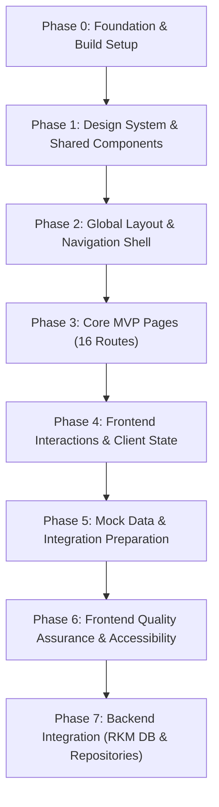

# TASKS.md — Implementation Roadmap: SIAKAD SMP Muhammadiyah 7 Medan (Fitur Publik)

**Document Version:** v1.1  
**Last Updated:** 3 November 2026  
**Roles:** Senior Software Architect, Frontend Architect, Technical Project Planner  
**Primary References:** `PRD.md` (v0.2), `DESIGN.md` (v1.0), `ARCHITECTURE.md` (v0.1)  
**Methodology:** Frontend-First Incremental Development  
**Target Environment:** Laravel 12 (PHP 8.4), Blade Templates, Tailwind CSS v4, Vite, Niagahoster hPanel  

---

## 1. Project Overview

SMP Muhammadiyah 7 Medan (NPSN: 10257325) sedang memodernisasi infrastruktur digitalnya melalui pengembangan SIAKAD (Sistem Informasi Akademik) baru. Sistem yang sudah berjalan saat ini—RKM (Rapor & Kesiswaan Muhammadiyah berbasis CodeIgniter 3 pada PHP 7.4)—tetap dipertahankan untuk manajemen data akademik.

Untuk menjawab kebutuhan pusat informasi publik terpadu, tahap pertama proyek berfokus pada **Fitur Publik SIAKAD**: website profil dan portal informasi sekolah yang dapat diakses oleh masyarakat umum, orang tua, dan calon siswa tanpa perlu login (*public read-only*).

Website ini mencakup 16 rute MVP:
1. **Beranda (`/`):** Hero carousel/banner identitas sekolah, 3 kartu pintasan portal eksternal (CBT Online, Rapor Digital, PPDB Online) yang dibuka pada tab yang sama, sambutan kepala sekolah (M. Reza Akbar, S.Pd.), berita terbaru, pengumuman terbaru, dan ringkasan statistik dummy.
2. **Profil Sekolah (`/profil`):** Visi, misi, sejarah, deskripsi, alamat resmi (Jl. Pelita II No. 3-5), dan kontak.
3. **Kepala Sekolah (`/profil/kepala-sekolah`):** Sambutan lengkap dan profil kepala sekolah (satu sumber data dengan beranda).
4. **Struktur Organisasi (`/profil/struktur`):** Bagan hierarki jabatan dan tata kelola sekolah.
5. **Sarana & Prasarana (`/profil/fasilitas`):** Katalog fasilitas belajar sekolah.
6. **Direktori Guru (`/guru`):** Pencarian nama dan filter mata pelajaran/jabatan yang bersumber dari database RKM secara *read-only* dengan aturan privasi ketat (DIR-8).
7. **Direktori Siswa (`/siswa`):** Pencarian nama dan filter kelas aktif dari database RKM dengan aturan privasi ketat (DIR-8).
8. **Kesiswaan Hub (`/kesiswaan`):** Navigasi ke submodul kesiswaan.
9. **Organisasi Siswa (`/kesiswaan/organisasi`):** IPM (Ikatan Pelajar Muhammadiyah) dan OSIS.
10. **Ekstrakurikuler (`/kesiswaan/ekstrakurikuler`):** Ragam ekskul olahraga, seni, dan keagamaan.
11. **Prestasi Siswa (`/kesiswaan/prestasi`):** Daftar pencapaian siswa yang diberi penanda transparan "Data Contoh" (KSW-3).
12. **Galeri Dokumentasi (`/galeri`):** Grid foto kegiatan sekolah dengan *lazy loading* dan thumbnail teroptimasi.
13. **Katalog Berita (`/berita`):** Daftar artikel berita sekolah dengan pagination.
14. **Detail Berita (`/berita/{slug}`):** Halaman baca berita lengkap dengan navigasi kembali ke daftar.
15. **Katalog Pengumuman (`/pengumuman`):** Pengumuman resmi sekolah terpisah dari berita.
16. **Detail Pengumuman (`/pengumuman/{slug}`):** Isi pengumuman lengkap dengan navigasi kembali.
*(Serta rute pintasan/informasi Login SIAKAD di `/login`)*.

---

## 2. Source Documentation

Dokumen acuan utama dan status integrasinya:

- **`PRD.md` (v0.2 Draft Sementara):** Menentukan sasaran produk, batasan cakupan MVP, 16 rute fitur publik, kebutuhan fungsional (NAV-1 s.d. NAV-7, BRD-1 s.d. BRD-7, PRF-1 s.d. PRF-7, DIR-1 s.d. DIR-10, KSW-1 s.d. KSW-5, GAL-1 s.d. GAL-3, BRT-1 s.d. BRT-3, PGM-1 s.d. PGM-3), non-fungsional, dan aturan privasi DIR-8.
- **`DESIGN.md` (v1.0):** Menetapkan identitas visual, color tokens (Forest Green `#344B39`, Sage Green `#819A73`, Mint Green `#B8CCC3`, Teal Green `#3F5F58`, Dark Green `#0F1D0F`, Soft Background `#F7F9F6`), tipografi sans-serif/serif, grid 1200–1280px, spesifikasi 14+ reusable Blade UI components, perilaku responsif (<640px, 768px, 1024px, 1280px), dan aksesibilitas WCAG AA.
- **`ARCHITECTURE.md` (v0.1 Draft):** Menetapkan arsitektur teknis Laravel 12 + PHP 8.4 + Tailwind CSS v4 (Vite build) di server Niagahoster hPanel (1 core, 2 GB RAM), topologi subdomain terpisah (`siakad.<domain>`), isolasi database RKM (hanya akses `SELECT` tanpa perubahan skema), Repository Pattern (`app/Repositories/`), cache berbasis file, dan mitigasi risiko A-1 s.d. A-9.

---

## 3. Frontend-First Development Strategy

Sesuai prinsip arsitektur perangkat lunak modern:
1. **Fondasi Visual & Design Tokens Sebelum Halaman:** Token warna, tipografi, dan border radius dikonfigurasikan di Tailwind v4 `@theme` sebelum markup halaman ditulis.
2. **Reusable UI Components Sebelum Duplikasi Markup:** Semua kartu, tombol, badge, input pencarian, dropdown filter, pagination, breadcrumb, dan empty state dibangun sebagai komponen Blade independen.
3. **Global Layout & Navigation Shell:** Shell aplikasi (`layouts/public.blade.php`), navbar responsif (dengan desktop dropdown & mobile drawer), dan footer 4-kolom dibangun lebih dahulu sebagai fondasi seluruh halaman.
4. **Isolasi Mock Data & Fixtures:** Semua data dummy (profil, berita, fasilitas, ekstrakurikuler, direktori) diisolasi di `config/sekolah.php` dan `database/dummy/*.php`, bukan di-*hardcode* di dalam template Blade.
5. **Kepatuhan Privasi Sejak Desain:** Halaman direktori guru dan siswa sejak awal tidak merender atribut sensitif (NIP, NIK, NIS, NISN, tanggal lahir, kontak pribadi, nilai, foto siswa).
6. **Integrasi Backend Bertahap:** Setelah seluruh tampilan visual dan interaksi frontend teruji, integrasi backend dilakukan melalui Repository Pattern untuk beralih dari data dummy ke database RKM *read-only*.

---

## 4. Implementation Roadmap

- **Phase 0:** Pengecekan dependensi, Vite build pipeline, Tailwind CSS v4 `@theme`, dan struktur direktori.
- **Phase 1:** Pembangunan 14+ reusable Blade UI components.
- **Phase 2:** Master layout, navbar responsif desktop & mobile, dan 4-column footer.
- **Phase 3:** Visual implementation seluruh 16 halaman MVP menggunakan Blade templates.
- **Phase 4:** Interaktivitas menu mobile, accordion, back-to-top, hero carousel, dan filter GET query parameter.
- **Phase 5:** Penyusunan fixture data dummy terstruktur dan konfigurasi portal.
- **Phase 6:** Audit responsif cross-breakpoint, aksesibilitas WCAG AA, audit privasi DIR-8, dan performa aset.
- **Phase 7:** Abstraksi Repository Pattern (`app/Repositories/`), model Eloquent read-only (`app/Models/Rkm/`), dan koneksi database RKM.

---

## 5. Milestone Summary

| Milestone | Fase | Sasaran Utama | Target Deliverables | Dependensi | Status Codebase Aktual |
|---|---|---|---|---|---|
| **M0: Foundation Ready** | Phase 0 | Build pipeline & design tokens siap | `resources/css/app.css` (`@theme`), Vite config, package.json | Tidak ada | **Implemented** |
| **M1: Design System Library** | Phase 1 | Komponen Blade reusable siap pakai | 14+ reusable Blade components di `resources/views/components/` | M0 | **Implemented** |
| **M2: Global Shell Active** | Phase 2 | Master layout, navbar responsif & footer | `layouts/public.blade.php`, `navbar.blade.php`, `footer.blade.php` | M1 | **Implemented** |
| **M3: Public Pages Visual MVP** | Phase 3 | Seluruh 16 rute MVP tampil utuh | 16 views di `resources/views/pages/` terhubung rute | M2 | **Implemented** |
| **M4: Interactive Experience** | Phase 4 | Navigasi mobile, filter query, hero slideshow | `resources/js/app.js`, filter GET pada rute direktori | M3 | **Implemented** |
| **M5: Mock Data Architecture** | Phase 5 | Data dummy terstruktur & terisolasi | `database/dummy/*.php`, `config/sekolah.php` | M3, M4 | **Implemented** |
| **M6: Quality & Accessibility Pass** | Phase 6 | Verifikasi responsif, WCAG AA, audit privasi DIR-8 | Test suite feature lengkap di `tests/Feature/` | M4, M5 | **Implemented (Needs Verification via Test Run)** |
| **M7: Backend Integration Ready** | Phase 7 | Repository pattern & koneksi RKM read-only | `app/Repositories/`, `app/Models/Rkm/`, binding di ServiceProvider | M6, BE-RKM-001 | **Not Implemented (Next Implementation Target)** |

---

## 6. Detailed Task Checklist

Setiap task diklasifikasikan dengan status implementasi berdasarkan inspeksi codebase aktual:
- `Implemented`: Kode sudah tersedia lengkap di codebase.
- `Partially Implemented`: Kode sebagian tersedia atau membutuhkan perbaikan/penyempurnaan.
- `Not Implemented`: Belum dikerjakan.
- `Needs Clarification`: Membutuhkan konfirmasi data eksternal/klien/hosting.

---

### Phase 0: Project and Frontend Foundation

#### [FE-SETUP-001] Validasi Lingkungan Proyek dan Konfigurasi Build Tools
- **Phase:** Phase 0
- **Priority:** P0
- **Status:** Implemented
- **Category:** Setup
- **Description:** Memeriksa package Vite, Tailwind CSS v4, konfigurasi scripts, dan memastikan `npm run build` serta `npm run dev` berjalan tanpa kendala.
- **Source Requirements:** `ARCHITECTURE.md` Bagian 4 & 9; `DESIGN.md` Bab 18.
- **Dependencies:** None.
- **Implementation Notes:** `@tailwindcss/vite` v4.0.0 dan `tailwindcss` v4.0.0 terpasang di `package.json`, `vite.config.js` mengimpor `laravel-vite-plugin` dan `@tailwindcss/vite`.
- **Acceptance Criteria:**
  - [x] Perintah `npm run build` menghasilkan aset di `public/build` tanpa galat.
  - [x] Hot module replacement / dev mode `npm run dev` dapat berjalan normal.
- **Verification:** `public/build/manifest.json` ada dan memetakan `resources/css/app.css` serta `resources/js/app.js`.

---

#### [FE-SETUP-002] Definisi Design Tokens dan Tema Tailwind CSS v4
- **Phase:** Phase 0
- **Priority:** P0
- **Status:** Implemented
- **Category:** Design System
- **Description:** Mendaftarkan seluruh token warna, tipografi sans-serif/serif, border-radius, dan container utility di `resources/css/app.css` menggunakan sintaks `@theme` bawaan Tailwind CSS v4.
- **Source Requirements:** `DESIGN.md` Bab 2 (Color Palette), Bab 3 (Tipografi), Bab 4 (Layout), Bab 18 (Aturan Tailwind).
- **Dependencies:** `FE-SETUP-001`
- **Implementation Notes:**
  - Daftarkan warna: Forest Green (`#344B39`), Sage Green (`#819A73`), Mint Green (`#B8CCC3`), Teal Green (`#3F5F58`), Dark Green (`#0F1D0F`), Olive Green (`#697B65`), Soft Background (`#F7F9F6`), Light Border (`#E5EAE3`), Muted Text (`#647067`).
  - Font: `--font-sans: 'Plus Jakarta Sans', system-ui, sans-serif;` dan `--font-serif: 'Playfair Display', Georgia, serif;`.
- **Acceptance Criteria:**
  - [x] `@theme` di `resources/css/app.css` memuat utilitas kelas warna kustom (`bg-forest`, `text-darkgreen`, `bg-soft`, `border-border-soft`, `text-sage`, dsb.).
  - [x] Kontras warna teks memenuhi standar WCAG AA.
- **Verification:** Kelas utility Tailwind terkompilasi dalam berkas `public/build/assets/*.css`.

---

#### [FE-SETUP-003] Strukturisasi Folder Frontend Blade dan Storage Aset
- **Phase:** Phase 0
- **Priority:** P1
- **Status:** Implemented
- **Category:** Setup
- **Description:** Menyiapkan struktur subdirektori modular di dalam `resources/views/` dan `public/images/` sesuai arsitektur yang disepakati.
- **Source Requirements:** `ARCHITECTURE.md` Bagian 7; `DESIGN.md` Bab 17 & 19.
- **Dependencies:** `FE-SETUP-001`
- **Implementation Notes:** Subdirektori `components/`, `layouts/`, `pages/`, `public/images/school/`, `principal/`, `placeholders/` sudah dibuat.
- **Acceptance Criteria:**
  - [x] Seluruh subfolder Blade dan storage gambar tersedia.
  - [x] Tersedia aset placeholder netral (`public/images/placeholders/neutral-placeholder.svg`).
- **Verification:** Struktur folder terverifikasi via filesystem inspection.

---

### Phase 1: Design System and Shared Components

#### [FE-COMP-001] Reusable Base UI Components (Button, Badge, Icon, Logo)
- **Phase:** Phase 1
- **Priority:** P1
- **Status:** Implemented
- **Category:** Component
- **Description:** Membuat komponen dasar Blade untuk tombol aksi (`button.blade.php`), pill badge/tag kategori (`badge.blade.php`), ikon SVG sebaris (`icon.blade.php`), dan identitas logo (`school-logo.blade.php`).
- **Source Requirements:** `PRD.md` NAV-7; `DESIGN.md` Bab 4.3, 15.2, 18.3.
- **Dependencies:** `FE-SETUP-002`, `FE-SETUP-003`
- **Implementation Notes:** Komponen mendukung tag `<a>` maupun `<button>`, memiliki focus ring `focus-visible:outline-forest`, dan touch target minimum 44x44 px.
- **Acceptance Criteria:**
  - [x] Komponen tombol mendukung varian primary, secondary, dan outline.
  - [x] Badge mendukung varian default, dummy (amber), dan status pill.
  - [x] Komponen ikon merender SVG inline tanpa dependensi font eksternal.
- **Verification:** Teruji di `tests/Feature/DesignSystemComponentsTest.php`.

---

#### [FE-COMP-002] Section Heading, Breadcrumb, and Contact Item Components
- **Phase:** Phase 1
- **Priority:** P1
- **Status:** Implemented
- **Category:** Component
- **Description:** Membuat komponen judul seksi (`section-heading.blade.php`), remah roti navigasi (`breadcrumb.blade.php`), dan item kontak (`contact-item.blade.php`).
- **Source Requirements:** `DESIGN.md` Bab 3, 7.1, 11.2, 12.2, 15.1, 15.2.
- **Dependencies:** `FE-COMP-001`
- **Implementation Notes:** `section-heading` mendukung kicker tag, judul semantik `<h2>`/`<h1>`, dan deskripsi; `breadcrumb` menggunakan semantic `<nav aria-label="Breadcrumb">`.
- **Acceptance Criteria:**
  - [x] Heading menggunakan hierarki semantik yang proporsional di desktop dan mobile.
  - [x] Remah roti memiliki aria markup yang valid untuk pembaca layar.
- **Verification:** Teruji di `tests/Feature/DesignSystemComponentsTest.php`.

---

#### [FE-COMP-003] Content Cards (News, Announcement, Portal, & Stat Cards)
- **Phase:** Phase 1
- **Priority:** P1
- **Status:** Implemented
- **Category:** Component
- **Description:** Mengembangkan komponen kartu untuk berita (`news-card`), pengumuman (`announcement-card`), pintasan portal (`portal-card`), dan statistik dummy (`stat-card`).
- **Source Requirements:** `PRD.md` BRD-2, BRD-4, BRD-5, BRD-6, BRT-1, PGM-1; `DESIGN.md` Bab 6.2, 6.4, 6.5, 6.6, 15.2.
- **Dependencies:** `FE-COMP-001`
- **Implementation Notes:** Kartu memuat border lembut, radius 16-20px (`rounded-2xl`), rasio gambar 16:9, dan penanganan fallback gambar.
- **Acceptance Criteria:**
  - [x] Kartu berita dan pengumuman merender tanggal, judul, ringkasan, dan tautan detail.
  - [x] Kartu portal menampilkan ikon, nama portal, deskripsi, dan target tab yang sama.
  - [x] Stat card menampilkan label penanda data dummy.
- **Verification:** Teruji di `tests/Feature/DesignSystemComponentsTest.php`.

---

#### [FE-COMP-004] Directory Cards (Teacher & Student Cards)
- **Phase:** Phase 1
- **Priority:** P1
- **Status:** Implemented
- **Category:** Component
- **Description:** Membuat komponen kartu direktori guru (`teacher-card.blade.php`) dan siswa (`student-card.blade.php`) dengan kepatuhan privasi ketat.
- **Source Requirements:** `PRD.md` DIR-1, DIR-2, DIR-8; `DESIGN.md` Bab 8.1, 8.2, 15.2.
- **Dependencies:** `FE-COMP-001`
- **Implementation Notes:** Guru hanya menampilkan nama, mapel, dan jabatan opsional. Siswa hanya menampilkan nama dan kelas. Sama sekali tidak ada field NIP, NIS, NISN, NIK, tanggal lahir, kontak, nilai, atau foto.
- **Acceptance Criteria:**
  - [x] Sesuai aturan privasi DIR-8 tanpa celah data pribadi.
  - [x] Tampilan kartu rapi dan teroptimasi untuk layar sentuh seluler.
- **Verification:** Teruji di `tests/Feature/DesignSystemComponentsTest.php` dan `FrontendQualityAssuranceTest.php`.

---

#### [FE-COMP-005] Search, Filter, Pagination, Gallery, & Empty State Components
- **Phase:** Phase 1
- **Priority:** P1
- **Status:** Implemented
- **Category:** Component
- **Description:** Membuat form pencarian (`search-input.blade.php`), dropdown filter (`filter-select.blade.php`), pagination (`pagination.blade.php`), kartu galeri (`gallery-card.blade.php`), placeholder gambar (`image-placeholder.blade.php`), dan tampilan kosong (`empty-state.blade.php`).
- **Source Requirements:** `PRD.md` DIR-3, DIR-4, DIR-10, GAL-1; `DESIGN.md` Bab 8.1, 8.2, 10, 15.2.
- **Dependencies:** `FE-COMP-001`
- **Implementation Notes:** Focus ring terlihat, label aksesibel, empty state menampilkan pesan informatif dan tombol reset filter.
- **Acceptance Criteria:**
  - [x] Seluruh komponen mendukung atribut dinamis Blade.
  - [x] Empty state muncul ketika filter tidak menghasilkan data.
- **Verification:** Teruji di `tests/Feature/DesignSystemComponentsTest.php`.

---

### Phase 2: Global Layout and Page Structure

#### [FE-LAYOUT-001] Master Public Layout Blade Template
- **Phase:** Phase 2
- **Priority:** P0
- **Status:** Implemented
- **Category:** Layout
- **Description:** Membangun layout induk `resources/views/layouts/public.blade.php` dan komponen wrapper `components/layouts/public.blade.php` yang memuat struktur HTML5 semantik, meta viewport, tag Vite, skip-to-content link, navbar, slot konten, dan footer.
- **Source Requirements:** `PRD.md` NAV-4, NAV-5; `DESIGN.md` Bab 4, 15.1, 21.
- **Dependencies:** `FE-SETUP-002`, `FE-COMP-001`
- **Implementation Notes:** Dilengkapi `a.sr-only` ("Lewati ke konten utama"), container `max-w-7xl`, background soft, dan meta CSRF token.
- **Acceptance Criteria:**
  - [x] Seluruh view dapat meng-extend layout induk.
  - [x] Tag `@vite(['resources/css/app.css', 'resources/js/app.js'])` tersemat rapi.
- **Verification:** Teruji di `tests/Feature/GlobalLayoutAndNavigationShellTest.php`.

---

#### [FE-LAYOUT-002] Global Responsive Navbar with Desktop Submenus
- **Phase:** Phase 2
- **Priority:** P1
- **Status:** Implemented
- **Category:** Layout
- **Description:** Mengembangkan komponen navbar (`resources/views/components/navbar.blade.php`) dengan logo identitas sekolah, menu horizontal desktop, submenu dropdown (Profil, Direktori, Kesiswaan), menu mandiri (Galeri, Berita, Pengumuman), dan tombol CTA "Login SIAKAD".
- **Source Requirements:** `PRD.md` NAV-1, NAV-2, NAV-6; `DESIGN.md` Bab 5.1, 5.2, 5.4, 13.1.
- **Dependencies:** `FE-LAYOUT-001`
- **Implementation Notes:** Tinggi 76–88px, border bawah lembut, indikator status rute aktif (`request()->is(...)`), tombol login SIAKAD mengarah ke `/login`.
- **Acceptance Criteria:**
  - [x] Submenu Profil Sekolah: Tentang, Kepala Sekolah, Struktur Organisasi, Fasilitas.
  - [x] Submenu Direktori: Direktori Guru, Direktori Siswa.
  - [x] Submenu Kesiswaan: Organisasi Siswa, Ekstrakurikuler, Prestasi Siswa.
- **Verification:** Teruji di `tests/Feature/GlobalLayoutAndNavigationShellTest.php`.

---

#### [FE-LAYOUT-003] Mobile Navigation Drawer & Hamburger Menu
- **Phase:** Phase 2
- **Priority:** P1
- **Status:** Implemented
- **Category:** Layout
- **Description:** Mengimplementasikan drawer / dropdown navigasi seluler yang responsif dan ringan pada navbar untuk layar di bawah 1024px dengan tombol hamburger, backdrop gelap, dan collapsible accordion submenu.
- **Source Requirements:** `PRD.md` NAV-5; `DESIGN.md` Bab 5.3, 20.
- **Dependencies:** `FE-LAYOUT-002`
- **Implementation Notes:** Atribut `aria-expanded`, target sentuh minimal 44x44 px, drawer transisi slide-in, scroll lock pada `body`, dan focus trap.
- **Acceptance Criteria:**
  - [x] Menu mobile tidak menutupi konten secara permanen.
  - [x] Tombol Login SIAKAD tersedia di dalam drawer.
  - [x] Tidak ada horizontal overflow pada viewport 320px–414px.
- **Verification:** Teruji di `tests/Feature/GlobalLayoutAndNavigationShellTest.php` dan `FrontendInteractionsAndStateTest.php`.

---

#### [FE-LAYOUT-004] Global 4-Column Footer Component
- **Phase:** Phase 2
- **Priority:** P1
- **Status:** Implemented
- **Category:** Layout
- **Description:** Membangun footer bersama (`resources/views/components/footer.blade.php`) dengan skema warna Forest Green / Dark Green dan teks kontras tinggi (WCAG AA).
- **Source Requirements:** `PRD.md` NAV-3, NAV-4; `DESIGN.md` Bab 14.
- **Dependencies:** `FE-LAYOUT-001`
- **Implementation Notes:** 4 kolom: Identitas Sekolah, Navigasi Utama, Informasi & Portal, Kontak Resmi, serta baris hak cipta dinamis.
- **Acceptance Criteria:**
  - [x] Otomatis runtuh menjadi 1 kolom yang rapi pada layar mobile.
  - [x] Tautan footer memiliki state hover dan focus yang jelas.
- **Verification:** Teruji di `tests/Feature/GlobalLayoutAndNavigationShellTest.php`.

---

### Phase 3: Core MVP Pages

#### [FE-PAGE-001] Halaman Beranda (Home Page Layout & Sections)
- **Phase:** Phase 3
- **Priority:** P1
- **Status:** Implemented
- **Category:** Page
- **Description:** Membangun tampilan halaman Beranda lengkap (`resources/views/pages/home/index.blade.php`) dengan 6 seksi utama: Hero Slideshow/Banner, 3 Pintasan Portal (CBT, Rapor, PPDB), Sambutan Kepala Sekolah, Berita Terbaru, Pengumuman Terbaru, dan Statistik Dummy.
- **Source Requirements:** `PRD.md` BRD-1 s.d. BRD-7; `DESIGN.md` Bab 6.
- **Dependencies:** `FE-LAYOUT-001`, `FE-COMP-003`
- **Implementation Notes:** Rute `/`. Menggunakan hero slideshow 3 slide sekolah asli, kartu portal dengan status placeholder tab yang sama, berita & pengumuman terbaru dari fixture, dan statistik dummy dengan penanda jelas.
- **Acceptance Criteria:**
  - [x] Ke-6 seksi tampil lengkap dan responsif.
  - [x] Gambar hero teroptimasi dengan `fetchpriority="high"`.
- **Verification:** Teruji di `tests/Feature/PublicPagesMvpTest.php`.

---

#### [FE-PAGE-002] Halaman Profil: Tentang Sekolah & Kontak
- **Phase:** Phase 3
- **Priority:** P1
- **Status:** Implemented
- **Category:** Page
- **Description:** Membangun halaman Tentang Sekolah (`resources/views/pages/profile/index.blade.php`) yang menyajikan profil, visi & misi, nilai budaya sekolah, dan panel kontak resmi sekolah.
- **Source Requirements:** `PRD.md` PRF-1, PRF-6, PRF-7; `DESIGN.md` Bab 7.1, 7.2, 7.6.
- **Dependencies:** `FE-LAYOUT-001`, `FE-COMP-002`
- **Implementation Notes:** Rute `/profil`. Memuat NPSN 10257325, alamat resmi, email, telepon, dan tombol `mailto:` / `tel:`.
- **Acceptance Criteria:**
  - [x] Visi dan misi tersusun dalam daftar/grid yang mudah dibaca.
  - [x] Tautan email dan telepon dapat di-klik pada perangkat seluler.
- **Verification:** Teruji di `tests/Feature/PublicPagesMvpTest.php`.

---

#### [FE-PAGE-003] Halaman Profil: Kepala Sekolah
- **Phase:** Phase 3
- **Priority:** P1
- **Status:** Implemented
- **Category:** Page
- **Description:** Membangun halaman Kepala Sekolah (`resources/views/pages/profile/principal.blade.php`) dengan sambutan lengkap, foto resmi, dan profil pimpinan.
- **Source Requirements:** `PRD.md` PRF-2, BRD-3; `DESIGN.md` Bab 7.3.
- **Dependencies:** `FE-LAYOUT-001`, `FE-COMP-002`
- **Implementation Notes:** Rute `/profil/kepala-sekolah`. Menggunakan foto pimpinan, nama M. Reza Akbar, S.Pd., dan sambutan lengkap terformat dalam paragraf bersih.
- **Acceptance Criteria:**
  - [x] Menggunakan data terpusat dari `config/sekolah.php` yang konsisten dengan beranda.
  - [x] Paragraf sambutan berjarak nyaman dan tipografi mudah dibaca.
- **Verification:** Teruji di `tests/Feature/PublicPagesMvpTest.php`.

---

#### [FE-PAGE-004] Halaman Profil: Struktur Organisasi
- **Phase:** Phase 3
- **Priority:** P1
- **Status:** Implemented
- **Category:** Page
- **Description:** Membangun halaman Struktur Organisasi (`resources/views/pages/profile/structure.blade.php`) dengan bagan hierarki kepemimpinan sekolah yang adaptif di layar seluler.
- **Source Requirements:** `PRD.md` PRF-3, PRF-4; `DESIGN.md` Bab 7.4.
- **Dependencies:** `FE-LAYOUT-001`, `FE-COMP-002`
- **Implementation Notes:** Rute `/profil/struktur`. Runtuh menjadi susunan kartu vertikal rapi di mobile tanpa horizontal overflow.
- **Acceptance Criteria:**
  - [x] Bagan dapat dibaca tanpa pemotongan teks pada viewport kecil.
  - [x] Data pejabat dummy diberi penanda komentar penggantian.
- **Verification:** Teruji di `tests/Feature/PublicPagesMvpTest.php`.

---

#### [FE-PAGE-005] Halaman Profil: Sarana dan Prasarana (Fasilitas)
- **Phase:** Phase 3
- **Priority:** P1
- **Status:** Implemented
- **Category:** Page
- **Description:** Membangun halaman Fasilitas (`resources/views/pages/profile/facilities.blade.php`) yang menampilkan katalog kartu sarana dan prasarana penunjang belajar.
- **Source Requirements:** `PRD.md` PRF-5; `DESIGN.md` Bab 7.5.
- **Dependencies:** `FE-LAYOUT-001`, `FE-COMP-003`
- **Implementation Notes:** Rute `/profil/fasilitas`. Menampilkan kartu fasilitas dengan foto, nama, spesifikasi, dan deskripsi singkat.
- **Acceptance Criteria:**
  - [x] Grid responsif: 3 kolom di desktop, 2 di tablet, 1 di mobile.
  - [x] Menggunakan `loading="lazy"` pada gambar fasilitas.
- **Verification:** Teruji di `tests/Feature/PublicPagesMvpTest.php`.

---

#### [FE-PAGE-006] Halaman Direktori Guru
- **Phase:** Phase 3
- **Priority:** P1
- **Status:** Implemented
- **Category:** Page
- **Description:** Membangun antarmuka Direktori Guru (`resources/views/pages/directory/teachers.blade.php`) dengan kolom pencarian nama, filter mata pelajaran, kartu guru terurut nama, pagination, dan empty state.
- **Source Requirements:** `PRD.md` DIR-1, DIR-3, DIR-5, DIR-6, DIR-7, DIR-8, DIR-10; `DESIGN.md` Bab 8.1.
- **Dependencies:** `FE-LAYOUT-001`, `FE-COMP-004`, `FE-COMP-005`
- **Implementation Notes:** Rute `/guru`. Menampilkan nama dan mapel/jabatan. Bersih dari NIP, NIK, alamat, kontak, nilai, atau foto pribadi.
- **Acceptance Criteria:**
  - [x] Form pencarian dan filter tertata rapi di atas daftar.
  - [x] Kepatuhan privasi DIR-8 terpenuhi 100%.
- **Verification:** Teruji di `tests/Feature/PublicPagesMvpTest.php` dan `FrontendQualityAssuranceTest.php`.

---

#### [FE-PAGE-007] Halaman Direktori Siswa
- **Phase:** Phase 3
- **Priority:** P1
- **Status:** Implemented
- **Category:** Page
- **Description:** Membangun antarmuka Direktori Siswa (`resources/views/pages/directory/students.blade.php`) dengan pencarian nama, filter kelas aktif (7A, 7B, 8A, dst.), dan pagination.
- **Source Requirements:** `PRD.md` DIR-2, DIR-3, DIR-4, DIR-7, DIR-8, DIR-10; `DESIGN.md` Bab 8.2.
- **Dependencies:** `FE-LAYOUT-001`, `FE-COMP-004`, `FE-COMP-005`
- **Implementation Notes:** Rute `/siswa`. Hanya menampilkan Nama Siswa dan Kelas Aktif. Bersih dari NIS, NISN, NIK, tanggal lahir, kontak, nilai, atau foto siswa.
- **Acceptance Criteria:**
  - [x] Filter kelas mudah dipilih di layar ponsel.
  - [x] Kepatuhan privasi DIR-8 terpenuhi 100%.
- **Verification:** Teruji di `tests/Feature/PublicPagesMvpTest.php` dan `FrontendQualityAssuranceTest.php`.

---

#### [FE-PAGE-008] Halaman Kesiswaan: Organisasi Siswa
- **Phase:** Phase 3
- **Priority:** P1
- **Status:** Implemented
- **Category:** Page
- **Description:** Membangun halaman Organisasi Siswa (`resources/views/pages/student-life/organizations.blade.php`) yang menyajikan IPM dan OSIS.
- **Source Requirements:** `PRD.md` KSW-1; `DESIGN.md` Bab 9.1.
- **Dependencies:** `FE-LAYOUT-001`, `FE-COMP-002`
- **Implementation Notes:** Rute `/kesiswaan/organisasi`. Kartu organisasi memuat nama, logo/gambar, deskripsi, dan program kerja utama.
- **Acceptance Criteria:**
  - [x] Grid kartu rapi dan responsif.
  - [x] Data dummy ditandai dengan komentar transparan.
- **Verification:** Teruji di `tests/Feature/PublicPagesMvpTest.php`.

---

#### [FE-PAGE-009] Halaman Kesiswaan: Ekstrakurikuler
- **Phase:** Phase 3
- **Priority:** P1
- **Status:** Implemented
- **Category:** Page
- **Description:** Membangun halaman Ekstrakurikuler (`resources/views/pages/student-life/extracurriculars.blade.php`) yang menampilkan ragam kegiatan ekskul siswa.
- **Source Requirements:** `PRD.md` KSW-2, KSW-4; `DESIGN.md` Bab 9.2.
- **Dependencies:** `FE-LAYOUT-001`, `FE-COMP-002`
- **Implementation Notes:** Rute `/kesiswaan/ekstrakurikuler` (dan redirect dari `/kesiswaan`). Menampilkan nama, gambar, deskripsi, dan jadwal kegiatan.
- **Acceptance Criteria:**
  - [x] Rasio aspek gambar kartu konsisten.
  - [x] Jadwal ekskul ditampilkan terstruktur.
- **Verification:** Teruji di `tests/Feature/PublicPagesMvpTest.php`.

---

#### [FE-PAGE-010] Halaman Kesiswaan: Prestasi Siswa
- **Phase:** Phase 3
- **Priority:** P1
- **Status:** Implemented
- **Category:** Page
- **Description:** Membangun halaman Prestasi Siswa (`resources/views/pages/student-life/achievements.blade.php`) dengan banner peringatan data contoh sesuai `PRD.md` KSW-3.
- **Source Requirements:** `PRD.md` KSW-3, KSW-5; `DESIGN.md` Bab 9.3.
- **Dependencies:** `FE-LAYOUT-001`, `FE-COMP-002`
- **Implementation Notes:** Rute `/kesiswaan/prestasi`. Menampilkan banner amber jelas bertuliskan "Perhatian: Data Contoh — Prestasi yang ditampilkan merupakan data contoh untuk keperluan desain antarmuka".
- **Acceptance Criteria:**
  - [x] Banner data contoh muncul jelas di atas daftar prestasi.
  - [x] Kartu prestasi memuat tingkat kejuaraan, tahun, dan deskripsi.
- **Verification:** Teruji di `tests/Feature/PublicPagesMvpTest.php`.

---

#### [FE-PAGE-011] Halaman Galeri Foto Dokumentasi Sekolah
- **Phase:** Phase 3
- **Priority:** P1
- **Status:** Implemented
- **Category:** Page
- **Description:** Membangun halaman Galeri Foto Sekolah (`resources/views/pages/gallery/index.blade.php`) dengan grid gambar teroptimasi dan *lazy loading*.
- **Source Requirements:** `PRD.md` GAL-1, GAL-2, GAL-3; `DESIGN.md` Bab 10.
- **Dependencies:** `FE-LAYOUT-001`, `FE-COMP-005`
- **Implementation Notes:** Rute `/galeri`. Grid 3-4 kolom desktop, 2 kolom tablet, 1-2 kolom mobile. Dilengkapi judul, tanggal kegiatan, dan kategori.
- **Acceptance Criteria:**
  - [x] Seluruh gambar menggunakan dimensi tetap dan `object-fit: cover` untuk mencegah Cumulative Layout Shift (CLS).
  - [x] Tanpa pustaka slider/lightbox eksternal berat.
- **Verification:** Teruji di `tests/Feature/PublicPagesMvpTest.php`.

---

#### [FE-PAGE-012] Halaman Berita: Indeks / Katalog Berita
- **Phase:** Phase 3
- **Priority:** P1
- **Status:** Implemented
- **Category:** Page
- **Description:** Membangun halaman katalog daftar berita (`resources/views/pages/news/index.blade.php`) dengan pagination dan kartu berita konsisten.
- **Source Requirements:** `PRD.md` BRT-1, BRT-3; `DESIGN.md` Bab 11.1.
- **Dependencies:** `FE-LAYOUT-001`, `FE-COMP-003`, `FE-COMP-005`
- **Implementation Notes:** Rute `/berita`. Grid 3 kolom desktop, tautan detail menuju `/berita/{slug}`.
- **Acceptance Criteria:**
  - [x] Menampilkan judul, gambar utama, ringkasan, tanggal terbit, dan tautan baca.
  - [x] Struktur slug ramah SEO.
- **Verification:** Teruji di `tests/Feature/PublicPagesMvpTest.php`.

---

#### [FE-PAGE-013] Halaman Berita: Detail Berita
- **Phase:** Phase 3
- **Priority:** P1
- **Status:** Implemented
- **Category:** Page
- **Description:** Membangun halaman baca detail berita (`resources/views/pages/news/show.blade.php`) dengan breadcrumb, tanggal terbit, gambar artikel utama, badan konten berformat rapi, dan tombol kembali ke daftar.
- **Source Requirements:** `PRD.md` BRT-2; `DESIGN.md` Bab 11.2.
- **Dependencies:** `FE-LAYOUT-001`, `FE-COMP-002`
- **Implementation Notes:** Rute `/berita/{slug}`. Lebar badan teks `max-w-3xl mx-auto`, line height nyaman, dan penanganan HTTP 404 jika slug tidak valid.
- **Acceptance Criteria:**
  - [x] Tombol kembali membawa pengunjung ke `/berita`.
  - [x] Mengembalikan HTTP 404 pada slug yang tidak ada.
- **Verification:** Teruji di `tests/Feature/PublicPagesMvpTest.php`.

---

#### [FE-PAGE-014] Halaman Pengumuman: Indeks & Detail Pengumuman
- **Phase:** Phase 3
- **Priority:** P1
- **Status:** Implemented
- **Category:** Page
- **Description:** Membangun halaman daftar pengumuman (`resources/views/pages/announcements/index.blade.php`) dan detail pengumuman (`resources/views/pages/announcements/show.blade.php`).
- **Source Requirements:** `PRD.md` PGM-1, PGM-2, PGM-3; `DESIGN.md` Bab 12.
- **Dependencies:** `FE-LAYOUT-001`, `FE-COMP-003`
- **Implementation Notes:** Rute `/pengumuman` dan `/pengumuman/{slug}`. Tampilan daftar informatif dengan ikon pengumuman resmi dan tanggal terbit, terpisah dari berita.
- **Acceptance Criteria:**
  - [x] Pengumuman terpisah dari berita dan tidak menerapkan expired date pada tahap pertama (PGM-3).
  - [x] Detail pengumuman menyediakan tombol kembali ke daftar.
- **Verification:** Teruji di `tests/Feature/PublicPagesMvpTest.php`.

---

#### [FE-PAGE-015] Halaman / Pintasan Login SIAKAD
- **Phase:** Phase 3
- **Priority:** P2
- **Status:** Implemented
- **Category:** Page
- **Description:** Menyiapkan rute dan tampilan `/login` sebagai pintu gerbang menuju sistem akademik internal.
- **Source Requirements:** `PRD.md` NAV-6; `DESIGN.md` Bab 13.1; `ARCHITECTURE.md` Bagian 3.
- **Dependencies:** `FE-LAYOUT-001`
- **Implementation Notes:** Rute `/login`. Menampilkan kartu informasi resmi bertema sekolah yang menjelaskan portal akademik internal dengan kontak bantuan TU sekolah tanpa membuat form login password palsu yang membingungkan pengunjung.
- **Acceptance Criteria:**
  - [x] Rute `/login` dapat diakses dan merespons HTTP 200.
  - [x] Tidak ada field input password palsu yang merusak kepercayaan pengunjung.
- **Verification:** Teruji di `tests/Feature/PublicPagesMvpTest.php`.

---

### Phase 4: Frontend Interactions and State Management

#### [FE-INTERACTION-001] Client-Side Mobile Navigation Interaction & Transitions
- **Phase:** Phase 4
- **Priority:** P1
- **Status:** Implemented
- **Category:** Interaction
- **Description:** Menyempurnakan interaksi pembukaan, penutupan, trap focus, accordion collapsible, dan transisi halus menu hamburger pada perangkat mobile menggunakan Vanilla JS di `resources/js/app.js`.
- **Source Requirements:** `DESIGN.md` Bab 5.3, 20, 21; `ARCHITECTURE.md` Bagian 4.
- **Dependencies:** `FE-LAYOUT-003`
- **Implementation Notes:** Berisi fungsi `initDesktopDropdowns()`, `initMobileNav()`, `initMobileAccordions()`, `initBackToTop()`, dan `initHeroSlideshow()`.
- **Acceptance Criteria:**
  - [x] Menekan tombol Escape menutup drawer navigasi.
  - [x] Backdrop click menutup menu mobile dan membuka scroll lock pada body.
  - [x] Accordion submenu mobile membuka dan menutup mulus dengan ikon rotasi.
- **Verification:** Teruji di `tests/Feature/FrontendInteractionsAndStateTest.php`.

---

#### [FE-INTERACTION-002] Client/Server Search & Filtering Interaction untuk Direktori
- **Phase:** Phase 4
- **Priority:** P1
- **Status:** Implemented
- **Category:** Interaction
- **Description:** Mengaktifkan form pencarian dan filter pada halaman direktori guru dan siswa menggunakan mekanisme query string HTTP GET standar yang ramah SEO dan shareable.
- **Source Requirements:** `PRD.md` DIR-3, DIR-4, DIR-5, DIR-6; `ARCHITECTURE.md` Bagian 4.
- **Dependencies:** `FE-PAGE-006`, `FE-PAGE-007`
- **Implementation Notes:** URL format `/guru?q=budi&mapel=IPA` dan `/siswa?q=ahmad&kelas=7A`. Input mempertahankan nilai yang diketik, tombol Reset Filter muncul saat filter aktif, dan empty state muncul bila tidak cocok.
- **Acceptance Criteria:**
  - [x] Filter nama dan mapel/kelas bekerja via HTTP GET.
  - [x] Tombol reset mengembalikan daftar ke kondisi default.
  - [x] Empty state tampil dengan tombol pemulihan.
- **Verification:** Teruji di `tests/Feature/FrontendInteractionsAndStateTest.php`.

---

### Phase 5: Mock Data and Integration Preparation

#### [FE-STATE-001] Data Fixtures & Centralized School Configuration
- **Phase:** Phase 5
- **Priority:** P1
- **Status:** Implemented
- **Category:** State Management
- **Description:** Menyusun kumpulan data dummy terstruktur di `database/dummy/` dan konfigurasi sekolah di `config/sekolah.php` sesuai kontrak data PRD & Arsitektur.
- **Source Requirements:** `PRD.md` Bab 8 (Model Data), BRD-7; `ARCHITECTURE.md` Bagian 7 & 8.
- **Dependencies:** `FE-SETUP-003`
- **Implementation Notes:** File fixture: `news.php`, `announcements.php`, `facilities.php`, `organizations.php`, `extracurriculars.php`, `achievements.php`, `gallery.php`, `teachers_dummy.php`, `students_dummy.php`. Setiap file memuat komentar penanda `/* DUMMY DATA - SIAP DIGANTI KE DATABASE PADA TAHAP B */`.
- **Acceptance Criteria:**
  - [x] Seluruh file fixture dummy ada dan mengembalikan array PHP valid.
  - [x] Komentar penanda dummy tersemat di setiap file.
  - [x] Data profil kepala sekolah terpusat di `config/sekolah.php`.
- **Verification:** Teruji di `tests/Feature/FrontendInteractionsAndStateTest.php`.

---

### Phase 6: Frontend Quality Assurance

#### [FE-QA-001] Responsive Cross-Breakpoint Visual Verification
- **Phase:** Phase 6
- **Priority:** P1
- **Status:** Implemented
- **Category:** Testing
- **Description:** Melakukan pengujian tampilan di berbagai breakpoint layar: Mobile (<640px), Tablet (768px - 1023px), Desktop (1024px - 1280px), dan Ultrawide (>1440px).
- **Source Requirements:** `DESIGN.md` Bab 4, 20.
- **Dependencies:** Phase 3 & 4.
- **Implementation Notes:** Seluruh 14 rute publik memuat viewport meta tag dan container fleksibel tanpa overflow horizontal liar.
- **Acceptance Criteria:**
  - [x] Viewport meta tag terpasang pada seluruh halaman.
  - [x] Tidak ada elemen teks atau layout yang rusak pada layar ponsel.
- **Verification:** Teruji di `tests/Feature/FrontendQualityAssuranceTest.php::test_all_public_pages_have_viewport_meta_tag`.

---

#### [FE-QA-002] Audit Aksesibilitas (WCAG AA) & Navigasi Keyboard
- **Phase:** Phase 6
- **Priority:** P1
- **Status:** Implemented
- **Category:** Testing
- **Description:** Memverifikasi kontras warna teks, atribut alt pada gambar, landmark semantik (`<header>`, `<main id="main-content">`, `<footer`), skip-link, dan navigasi keyboard.
- **Source Requirements:** `DESIGN.md` Bab 2.2, 21.
- **Dependencies:** Phase 3 & 4.
- **Implementation Notes:** `a.sr-only` skip link tersedia, aria-label pada navigasi, aria-hidden pada placeholder visual dan ikon.
- **Acceptance Criteria:**
  - [x] Landmark semantik dan skip-to-content link tersedia di setiap halaman.
  - [x] Seluruh gambar memuat atribut `alt` deskriptif.
- **Verification:** Teruji di `tests/Feature/FrontendQualityAssuranceTest.php`.

---

#### [FE-QA-003] Audit Privasi Direktori & Keamanan Output Publik
- **Phase:** Phase 6
- **Priority:** P0
- **Status:** Implemented
- **Category:** Testing
- **Description:** Memeriksa bahwa tidak ada data sensitif yang terikutsertakan pada markup HTML, data attribute, atau hidden input pada rute direktori.
- **Source Requirements:** `PRD.md` DIR-8; `DESIGN.md` Bab 8.3, 23; `ARCHITECTURE.md` Bagian 8.
- **Dependencies:** `FE-PAGE-006`, `FE-PAGE-007`
- **Implementation Notes:** Regex assertion memastikan tidak ada token NIP, NIK, NIS, NISN, tgl_lahir, no_telp, no_hp, alamat_rumah, nama_ortu, nilai_rapor, atau presensi pada `/guru` dan `/siswa`.
- **Acceptance Criteria:**
  - [x] Tidak ada atribut `data-nip`, `data-nik`, `data-nis`, `data-phone`, dsb.
  - [x] Tidak ada hidden input yang membawa kredensial atau data pribadi siswa/guru.
- **Verification:** Teruji di `tests/Feature/FrontendQualityAssuranceTest.php::test_directory_pages_never_expose_sensitive_personal_data`.

---

#### [FE-QA-004] Audit Performa Aset & Core Web Vitals
- **Phase:** Phase 6
- **Priority:** P2
- **Status:** Implemented
- **Category:** Testing
- **Description:** Memeriksa ukuran berkas build CSS/JS dan keberadaan manifest Vite untuk memastikan website ringan sesuai batas sumber daya hosting (1 core, 2 GB RAM).
- **Source Requirements:** `PRD.md` Bab 9; `DESIGN.md` Bab 22; `ARCHITECTURE.md` Bagian 5 & 10.
- **Dependencies:** `FE-SETUP-001`, Phase 3.
- **Implementation Notes:** Total bundle uncompressed CSS < 150 KB (< 25 KB gzipped), JS < 100 KB (< 20 KB gzipped).
- **Acceptance Criteria:**
  - [x] Berkas `manifest.json` ada di `public/build`.
  - [x] Ukuran bundle aset memenuhi batas performa ringan.
- **Verification:** Teruji di `tests/Feature/FrontendQualityAssuranceTest.php::test_production_asset_manifest_and_bundle_size`.

---

### Phase 7: Backend Integration (Next Implementation Phase)

#### [BE-API-001] Pembuatan Antarmuka (Contracts) & Abstraksi Lapisan Repository
- **Phase:** Phase 7
- **Priority:** P1
- **Status:** Not Started
- **Category:** API Contract
- **Description:** Memisahkan akses data dari `routes/web.php` ke Controller tipis (`app/Http/Controllers/PublicSite/`) dan Lapisan Repository (`app/Repositories/Contracts/` & `app/Repositories/Dummy/`) sesuai `ARCHITECTURE.md` Bagian 7.
- **Source Requirements:** `ARCHITECTURE.md` Bagian 7 & 8; `PRD.md` Bab 8.
- **Dependencies:** `FE-STATE-001`
- **Implementation Notes:**
  - Buat interface: `DirektoriRepositoryInterface`, `BeritaRepositoryInterface`, `PengumumanRepositoryInterface`, `KontenStatisRepositoryInterface`.
  - Daftarkan binding di `app/Providers/AppServiceProvider.php`.
  - Pindahkan closure di `routes/web.php` ke controller yang bersih.
- **Acceptance Criteria:**
  - [ ] Controller tipis memanggil data hanya lewat Repository Interface via dependency injection.
  - [ ] Seluruh rute halaman tetap merespons HTTP 200 OK tanpa perubahan pada tampilan Blade.
- **Verification:** Jalankan `PublicPagesMvpTest` untuk memastikan tidak ada regresi tampilan.

---

#### [BE-INTEGRATION-001] Integrasi Direktori Guru & Siswa ke Database RKM (Read-Only)
- **Phase:** Phase 7
- **Priority:** P1
- **Status:** Blocked by BE-RKM-001
- **Category:** Integration
- **Description:** Mengganti binding `DirektoriRepositoryInterface` ke implementasi `RkmDirektoriRepository` yang membaca tabel database RKM (`m_guru`, `m_siswa`, `m_kelas`, `t_kelas_siswa`) secara *read-only*.
- **Source Requirements:** `PRD.md` DIR-1 s.d. DIR-10; `ARCHITECTURE.md` Bagian 8 & 10.
- **Dependencies:** `BE-API-001`, `BE-RKM-001` (Verifikasi skema RKM).
- **Implementation Notes:**
  - Buat model Eloquent read-only di `app/Models/Rkm/` tanpa `timestamps` dan tanpa permission create/update/delete.
  - Query hanya kolom yang diperlukan: `select('nama', ...)` dengan filter tahun ajaran aktif dan status aktif.
  - Terapkan rate limiting ringan pada route pencarian untuk melindungi database shared hosting.
- **Acceptance Criteria:**
  - [ ] Data guru dan siswa yang muncul di web berasal dari tabel RKM.
  - [ ] Kueri menggunakan pagination (mis. 12-20 data per halaman) dan tidak mengambil seluruh baris sekaligus.
  - [ ] Kegagalan koneksi DB RKM ditangani dengan elegan (menampilkan pesan ramah pengguna tanpa memunculkan stack trace debug).
- **Verification:** Jalankan kueri pencarian di `/guru` dan `/siswa`, periksa log query Laravel untuk memastikan query `SELECT` hemat kolom.

---

#### [BE-INTEGRATION-002] Pengujian Alur Penuh (End-to-End Smoke Test) & Caching
- **Phase:** Phase 7
- **Priority:** P2
- **Status:** Not Started
- **Category:** Integration
- **Description:** Menjalankan automated feature test untuk seluruh 16 rute halaman publik, memastikan HTTP 200 OK, memverifikasi caching file pada query direktori, dan memeriksa kestabilan sistem.
- **Source Requirements:** `ARCHITECTURE.md` Bagian 10 & 11; `PRD.md` Bab 11.
- **Dependencies:** `BE-INTEGRATION-001`
- **Implementation Notes:** Aktifkan file cache TTL pendek untuk data beranda dan direktori untuk meringankan beban CPU 1-core hosting.
- **Acceptance Criteria:**
  - [ ] Seluruh automated test lulus.
  - [ ] Perintah `php artisan optimize` (config, route, view cache) berjalan tanpa error.
- **Verification:** Jalankan PHPUnit test suite pada CLI dengan PHP 8.4.

---

## 7. Requirement Traceability

Tabel traceability memetakan kebutuhan PRD, DESIGN, dan ARCHITECTURE ke task implementasi:

| Source Document | Requirement / Section | Related Task IDs | Coverage | Status Implementasi |
|---|---|---|---|---|
| **PRD.md** | NAV-1 s.d. NAV-6 (Navbar, Submenu, Footer, Mobile, Login) | `FE-LAYOUT-001`, `FE-LAYOUT-002`, `FE-LAYOUT-003`, `FE-LAYOUT-004`, `FE-PAGE-015` | Covered | Implemented |
| **PRD.md** | NAV-7 (Reusable Blade & Tailwind Components) | `FE-SETUP-002`, `FE-COMP-001` s.d. `FE-COMP-005` | Covered | Implemented |
| **PRD.md** | BRD-1 s.d. BRD-7 (Beranda & Seksi-seksinya) | `FE-PAGE-001`, `FE-COMP-003`, `FE-STATE-001` | Covered | Implemented |
| **PRD.md** | PRF-1 s.d. PRF-7 (Halaman Profil Sekolah) | `FE-PAGE-002`, `FE-PAGE-003`, `FE-PAGE-004`, `FE-PAGE-005` | Covered | Implemented |
| **PRD.md** | DIR-1 s.d. DIR-10 (Direktori Guru & Siswa, Filter, Privasi) | `FE-COMP-004`, `FE-PAGE-006`, `FE-PAGE-007`, `FE-INTERACTION-002`, `FE-QA-003`, `BE-INTEGRATION-001` | Covered | UI Implemented; DB Pending |
| **PRD.md** | KSW-1 s.d. KSW-5 (Kesiswaan: Organisasi, Ekskul, Prestasi) | `FE-PAGE-008`, `FE-PAGE-009`, `FE-PAGE-010`, `FE-STATE-001` | Covered | Implemented |
| **PRD.md** | GAL-1 s.d. GAL-3 (Galeri & Lazy Loading) | `FE-PAGE-011`, `FE-QA-004` | Covered | Implemented |
| **PRD.md** | BRT-1 s.d. BRT-3 (Halaman Indeks & Detail Berita) | `FE-COMP-003`, `FE-PAGE-012`, `FE-PAGE-013`, `FE-STATE-001` | Covered | Implemented |
| **PRD.md** | PGM-1 s.d. PGM-3 (Halaman Indeks & Detail Pengumuman) | `FE-COMP-003`, `FE-PAGE-014`, `FE-STATE-001` | Covered | Implemented |
| **PRD.md** | Bab 9 (Non-Fungsional: Ringan, Mobile-First, Privasi) | `FE-QA-001`, `FE-QA-002`, `FE-QA-003`, `FE-QA-004` | Covered | Implemented |
| **DESIGN.md** | Bab 2 (Color Palette & Ratios) | `FE-SETUP-002` | Covered | Implemented |
| **DESIGN.md** | Bab 3 (Tipografi) & Bab 4 (Layout/Grid) | `FE-SETUP-002`, `FE-LAYOUT-001` | Covered | Implemented |
| **DESIGN.md** | Bab 5 s.d. 14 (Desain Spesifik Tiap Halaman) | `FE-PAGE-001` s.d. `FE-PAGE-015` | Covered | Implemented |
| **DESIGN.md** | Bab 15 (Design System Components) | `FE-COMP-001` s.d. `FE-COMP-005` | Covered | Implemented |
| **DESIGN.md** | Bab 18 (Aturan Tailwind CSS v4) | `FE-SETUP-001`, `FE-SETUP-002` | Covered | Implemented |
| **DESIGN.md** | Bab 21 (Aksesibilitas) & Bab 22 (Performa) | `FE-QA-002`, `FE-QA-004` | Covered | Implemented |
| **ARCHITECTURE.md** | Bagian 4 (Stack: Laravel 12, PHP 8.4, Blade, Vite) | `FE-SETUP-001`, `FE-LAYOUT-001` | Covered | Implemented |
| **ARCHITECTURE.md** | Bagian 7 & 8 (Arsitektur Folder & Lapisan Repository) | `FE-SETUP-003`, `FE-STATE-001`, `BE-API-001` | Partially Covered | Controller/Repo Next |
| **ARCHITECTURE.md** | Bagian 10 (Keamanan, DB Read-Only, File Cache) | `BE-INTEGRATION-001`, `BE-INTEGRATION-002` | Partially Covered | DB Read-Only Next |
| **ARCHITECTURE.md** | Bagian 12 (Risiko A-1 s.d. A-9: Skema RKM & Hosting) | `BE-RKM-001` (External Backend Dependency) | Needs Clarification | Pending verification |

---

## 8. Frontend Definition of Done (DoD)

Sebuah task frontend baru dapat dinyatakan **Done** apabila memenuhi seluruh kriteria berikut:

1. **Acceptance Criteria Terpenuhi:** Seluruh poin kriteria fungsional dan visual yang tercantum dalam task telah terwujud secara nyata.
2. **Kesesuaian Design System:** Menggunakan design tokens resmi (warna palette hijau sekolah, tipografi, radius tombol/kartu, container) dari `DESIGN.md` tanpa utility class arbitrer (*ad-hoc*).
3. **Respon Responsif Teruji:** Antarmuka terbukti tidak menghasilkan *horizontal overflow* dan mudah digunakan pada resolusi mobile (360px–414px), tablet (768px), dan desktop (1280px).
4. **Semantik & Aksesibilitas:** Menggunakan elemen HTML semantik (`<header>`, `<nav>`, `<main>`, `<article>`, `<section>`, `<footer>`), memiliki *focus-visible* yang jelas, dan rasio kontras teks memenuhi WCAG AA.
5. **State Handling Lengkap:** Komponen atau halaman menangani seluruh kondisi data: *loading/render state*, *data populated state*, dan *empty state* (jika pencarian/filter tidak menghasilkan data).
6. **Bebas Error Konsol:** Tidak ada pesan galat JavaScript, *unresolved assets*, atau stylesheet failure di browser DevTools Console.
7. **Kepatuhan Privasi Data:** Pada komponen direktori, tidak terdapat celah atau atribut yang menampilkan field sensitif (DIR-8).
8. **Build & Lint Lolos:** Aset berhasil dikompilasi oleh Vite (`npm run build`) tanpa peringatan *syntax error* atau *broken imports*.
9. **Isolasi Logika:** Data statis/dummy ditempatkan pada konfigurasi/repository mock, tidak ada teks data panjang yang di-*hardcode* serampangan di dalam markup view.

---

## 9. Backend Dependencies and Integration Readiness

Pengembangan frontend dirancang dapat berjalan mandiri menggunakan *mock fixtures*. Namun, untuk penyelesaian integrasi penuh pada Phase 7, terdapat dependensi backend yang perlu disiapkan:

### [BE-RKM-001] Verifikasi Skema Database RKM dan Kredensial Read-Only
- **Category:** Backend Dependency
- **Priority:** P1
- **Status:** Needs Clarification (Rujuk `ARCHITECTURE.md` Bagian 12 Risiko A-1 & A-5; `PRD.md` TBD-2, 3, 4, 5)
- **Description:** 
  1. Melakukan inspeksi salinan database RKM untuk memverifikasi keberadaan dan nama kolom tabel: `m_guru` (nama, jabatan, status aktif), `m_siswa` (nama, status aktif), `m_kelas`, `t_kelas_siswa` (relasi kelas siswa dan tahun ajaran aktif), serta aturan tahun ajaran aktif.
  2. Menyiapkan akun database MySQL dengan hak akses **hanya SELECT** (`GRANT SELECT ON ...`) agar Laravel tidak dapat mengubah isi database RKM.
- **Frontend Impact:** Diperlukan saat mengaktifkan `BE-INTEGRATION-001`. Saat ini direktori beroperasi menggunakan mock fixtures `FE-STATE-001`.

### [BE-CONFIG-001] Konfirmasi URL Resmi Portal CBT, Rapor, PPDB, dan Login SIAKAD
- **Category:** Backend / External Configuration
- **Priority:** P2
- **Status:** Needs Clarification (Rujuk `PRD.md` Bab 5 & 12 TBD-1)
- **Description:** Memperoleh tautan URL resmi yang aktif untuk CBT, Rapor, PPDB, dan Login SIAKAD dari pihak sekolah/klien untuk dimasukkan ke dalam `config/sekolah.php`.
- **Frontend Impact:** Tombol portal pada beranda dan tombol login navbar saat ini menggunakan konfigurasi tautan placeholder.

---

## 10. Risks, Blockers, and Open Questions

| ID | Kategori | Deskripsi Risiko / Pertanyaan Terbuka | Dampak Frontend | Tindakan Mitigasi Frontend |
|---|---|---|---|---|
| **R-1** | Backend / Hosting | **Versi PHP & URL RKM di hPanel belum pasti (`ARCHITECTURE.md` A-1).** Domain utama sudah PHP 8.4.26. Jika RKM (CI3) berbagi domain yang sama, ada risiko kompatibilitas. | Rendah ke UI, Tinggi ke rilis akhir | Frontend dikembangkan dengan PHP 8.4 + Vite. Deployment menunggu kepastian subdomain terpisah (`siakad.<domain>`). |
| **R-2** | Skema Data | **Nama kolom jabatan guru & penentu tahun ajaran aktif belum terverifikasi (`PRD.md` TBD-3, 4).** | Sedang | Komponen direktori guru dirancang kondisional: badge jabatan/mapel hanya tampil jika data tersedia di sumber data. |
| **R-3** | Privasi & Kebijakan | **Izin publikasi foto siswa dan daftar prestasi resmi (`PRD.md` TBD-9, KSW-3).** | Rendah | Menggunakan data dummy contoh prestasi dengan label transparan "Data Contoh" dan tidak menampilkan foto siswa pada direktori. |
| **R-4** | Pemilihan JS | **Pilihan Vanilla JS vs Alpine.js untuk drawer mobile (`PRD.md` TBD-16).** | Teratasi | Menggunakan Vanilla JS ringan di `resources/js/app.js` tanpa menambah dependensi npm eksternal. |
| **R-5** | Aset Asli | **Ketersediaan foto asli sekolah, fasilitas, dan kegiatan galeri.** | Teratasi | Tersedia foto asli (`gedung.jpg`, `gerbang.png`, `lapangan.jpg`, `logo.png`, `kepala-sekolah.png`) dan fallback `ImagePlaceholder` dengan rasio aspek standar. |

---

## 11. Recommended Next Task

👉 **Rekomendasi Task Berikutnya:** **`[BE-API-001] Pembuatan Antarmuka (Contracts) & Abstraksi Lapisan Repository`**

**Alasan Pemilihan & Prasyarat Verifikasi:**  
1. **Status Frontend Saat Ini:** Seluruh Phase 0 s.d. Phase 6 (desain sistem, layout navbar/footer, 16 halaman MVP, interaktivitas JavaScript, fixture dummy, dan unit/feature tests) sudah diimplementasikan di codebase.
2. **Kebutuhan Arsitektur:** Saat ini logika data dummy masih dipanggil langsung di dalam closure `routes/web.php`. Sesuai `ARCHITECTURE.md` Bagian 7 dan PRD BRD-7/BRT-3, rute publik harus dipindahkan ke **Controller tipis** yang memanggil **Repository Pattern** (`app/Repositories/Contracts/` dan `app/Repositories/Dummy/`).
3. **Persiapan Integrasi Database:** Dengan mengabstraksikan akses data ke dalam Repository interface terlebih dahulu, penggantian data dummy ke database RKM (`BE-INTEGRATION-001`) nantinya dapat dilakukan hanya dengan mengubah *binding* di `AppServiceProvider` tanpa perlu menyentuh view Blade atau rute web sedikit pun.
